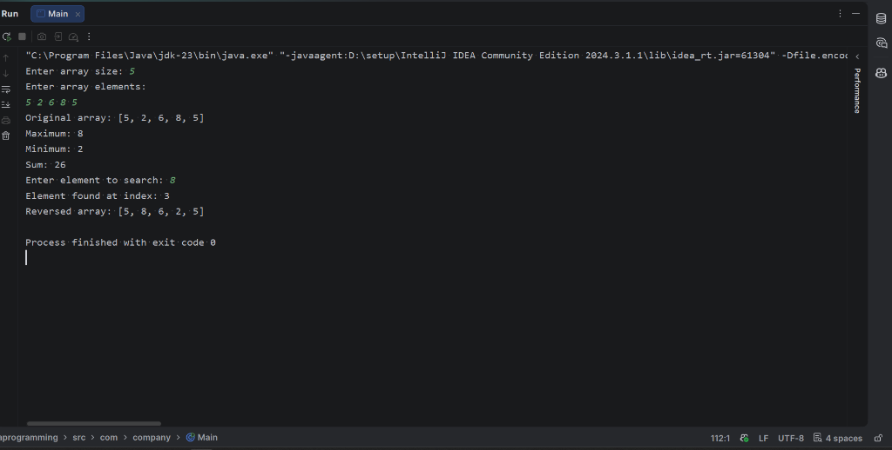

# 01 - Basic Array Operations

## 1. Problem Statement
Develop a Java program to implement and demonstrate fundamental operations on a one-dimensional array of integers. The program must perform:
- Array traversal and display
- Finding the maximum and minimum elements
- Calculating the sum of all elements
- Searching for a target element using Linear Search
- Reversing the array in-place using two-pointer technique

---

## 2. Approach
1. **Array Traversal (`display`)**:
   - Iterate through the elements or utilize standard formatting to display current contents.
2. **Extreme Value Identification (`findMax` & `findMin`)**:
   - Initialize `max` and `min` with the first element (`arr[0]`).
   - Iterate from index `1` to `n - 1`. If an element is greater than `max`, update `max`. If an element is smaller than `min`, update `min`.
3. **Summation (`sum`)**:
   - Initialize an accumulator variable `total = 0`.
   - Traverse the array sequentially and add each element to `total`.
4. **Linear Search (`search`)**:
   - Sequentially compare each element from index `0` to `n - 1` with the `target`.
   - Return the index if a match is found; return `-1` if the end of the array is reached without a match.
5. **In-place Reversal (`reverse`)**:
   - Initialize two pointers: `i = 0` (beginning) and `j = n - 1` (end).
   - Swap `arr[i]` and `arr[j]`, then increment `i` and decrement `j` until `i >= j`.

---

## 3. Pseudocode

```text
Algorithm: ArrayOperations

Function findMax(arr, n):
    max <- arr[0]
    For i <- 1 to n - 1:
        If arr[i] > max Then
            max <- arr[i]
    Return max

Function findMin(arr, n):
    min <- arr[0]
    For i <- 1 to n - 1:
        If arr[i] < min Then
            min <- arr[i]
    Return min

Function sum(arr, n):
    total <- 0
    For i <- 0 to n - 1:
        total <- total + arr[i]
    Return total

Function search(arr, n, target):
    For i <- 0 to n - 1:
        If arr[i] == target Then
            Return i
    Return -1

Function reverse(arr, n):
    i <- 0, j <- n - 1
    While i < j Do:
        temp <- arr[i]
        arr[i] <- arr[j]
        arr[j] <- temp
        i <- i + 1
        j <- j - 1
```

---

## 4. Time & Space Complexity Analysis

| Operation | Best Case Time | Average Case Time | Worst Case Time | Auxiliary Space |
| :--- | :---: | :---: | :---: | :---: |
| **Display** | $\mathcal{O}(n)$ | $\mathcal{O}(n)$ | $\mathcal{O}(n)$ | $\mathcal{O}(1)$ |
| **Find Maximum** | $\mathcal{O}(n)$ | $\mathcal{O}(n)$ | $\mathcal{O}(n)$ | $\mathcal{O}(1)$ |
| **Find Minimum** | $\mathcal{O}(n)$ | $\mathcal{O}(n)$ | $\mathcal{O}(n)$ | $\mathcal{O}(1)$ |
| **Summation** | $\mathcal{O}(n)$ | $\mathcal{O}(n)$ | $\mathcal{O}(n)$ | $\mathcal{O}(1)$ |
| **Linear Search** | $\mathcal{O}(1)$ *(first element)* | $\mathcal{O}(n)$ | $\mathcal{O}(n)$ *(last element / absent)* | $\mathcal{O}(1)$ |
| **In-place Reversal** | $\mathcal{O}(n)$ | $\mathcal{O}(n)$ | $\mathcal{O}(n)$ | $\mathcal{O}(1)$ |

- **Total Space Complexity**: $\mathcal{O}(n)$ to store the array elements in memory.

---

## 5. Sample Input & Output

### Input
```text
Enter array size: 5
Enter array elements:
5 2 6 8 5
Enter element to search: 8
```

### Output
```text
Original array: [5, 2, 6, 8, 5]
Maximum: 8
Minimum: 2
Sum: 26
Element found at index: 3
Reversed array: [5, 8, 6, 2, 5]
```

---

## 6. Output Screenshot



---

## 7. Learning Outcomes
- Gained hands-on understanding of contiguous memory layout and zero-based indexing in Java arrays.
- Implemented single-pass linear scan algorithms for aggregation (sum) and extreme-value search (min/max).
- Mastered the two-pointer technique for in-place array manipulation without allocating extra auxiliary memory.
- Understood theoretical time and space complexity trade-offs for elementary array algorithms.
