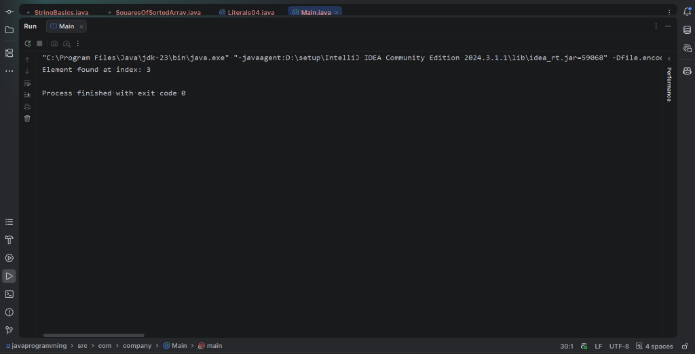

# 02 - Iterative Binary Search

## 1. Problem Statement
Implement an iterative Binary Search algorithm in Java to search for a target element within a sorted integer array. If the target is present in the array, the program must return its zero-based index; otherwise, it must indicate that the element was not found.

---

## 2. Approach
Binary Search is an efficient divide-and-conquer search technique applicable to sorted collections:
1. **Search Space Definition**: Maintain two pointer variables, `start = 0` and `end = arr.length - 1`, bounding the active search sub-array.
2. **Loop Invariant**: Continue the search while `start <= end`.
3. **Mid Calculation**: Compute the middle index using `mid = start + (end - start) / 2` to prevent potential 32-bit integer overflow.
4. **Comparison**:
   - If `arr[mid] == target`, the element is found; return `mid`.
   - If `arr[mid] < target`, the target must lie in the right sub-array. Discard the left half by setting `start = mid + 1`.
   - If `arr[mid] > target`, the target must lie in the left sub-array. Discard the right half by setting `end = mid - 1`.
5. **Termination**: If `start > end`, the search space has shrunk to zero without finding the element; return `-1`.

---

## 3. Pseudocode

```text
Algorithm: IterativeBinarySearch(arr, target)
Input: A sorted array arr of size n, and target value to search
Output: Index of target if found, else -1

start <- 0
end <- n - 1

While start <= end Do:
    mid <- start + (end - start) / 2
    
    If arr[mid] == target Then:
        Return mid
    Else If arr[mid] < target Then:
        start <- mid + 1
    Else:
        end <- mid - 1

Return -1
```

---

## 4. Time & Space Complexity Analysis

| Metric | Complexity | Explanation |
| :--- | :---: | :--- |
| **Best Case Time** | $\mathcal{O}(1)$ | Target element is located at the initial middle index `mid`. |
| **Average Case Time** | $\mathcal{O}(\log n)$ | Search interval is halved in each step ($n \rightarrow \frac{n}{2} \rightarrow \frac{n}{4} \dots$). |
| **Worst Case Time** | $\mathcal{O}(\log n)$ | Target is either at the extreme end or absent from the array. |
| **Auxiliary Space** | $\mathcal{O}(1)$ | Iterative implementation uses only a constant number of pointer variables (`start`, `end`, `mid`). |

---

## 5. Sample Input & Output

### Input
- **Array**: `[2, 4, 6, 8, 10, 12]`
- **Target**: `8`

### Output
```text
Element found at index: 3
```

---

## 6. Output Screenshot



---

## 7. Learning Outcomes
- Understood the requirement of **pre-sorted data** for binary search applicability.
- Mastered iterative search-space halving yielding logarithmic $\mathcal{O}(\log n)$ time efficiency compared to $\mathcal{O}(n)$ linear search.
- Learned safe midpoint computation `start + (end - start) / 2` to avoid integer overflow issues in large datasets.
- Confirmed that iterative binary search achieves optimal $\mathcal{O}(1)$ auxiliary space without recursion stack overhead.
