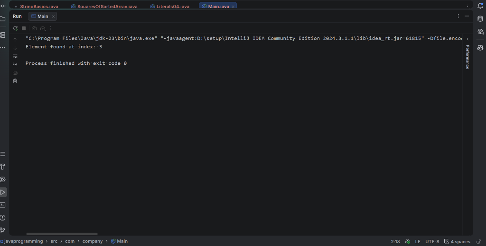

# 03 - Recursive Binary Search

## 1. Problem Statement
Implement a recursive Binary Search algorithm in Java to locate the index of a specified target key within a sorted array of integers. If the key exists, return its zero-based index; otherwise, return `-1` to signify its absence.

---

## 2. Approach
Recursive Binary Search models the **Divide and Conquer** algorithmic paradigm:
1. **Divide**: Calculate the middle element of the active range using `mid = start + (end - start) / 2`.
2. **Conquer / Base Cases**:
   - **Target Found**: If `arr[mid] == target`, return `mid`.
   - **Exhaustion (Not Found)**: If `start > end`, the search range is invalid/exhausted; return `-1`.
3. **Recursive Step**:
   - If `arr[mid] < target`, the target can only reside in the right half. Recurse on `binarySearch(arr, mid + 1, end, target)`.
   - If `arr[mid] > target`, the target can only reside in the left half. Recurse on `binarySearch(arr, start, mid - 1, target)`.

### Recurrence Relation:
$$T(n) = T\left(\frac{n}{2}\right) + \mathcal{O}(1)$$
By the Master Theorem ($a = 1, b = 2, d = 0$ where $\log_b a = 0 = d$):
$$T(n) = \Theta(\log n)$$

---

## 3. Pseudocode

```text
Algorithm: RecursiveBinarySearch(arr, start, end, target)
Input: Sorted array arr, search bounds [start, end], target value
Output: Index of target if found, else -1

If start > end Then:
    Return -1

mid <- start + (end - start) / 2

If arr[mid] == target Then:
    Return mid
Else If arr[mid] < target Then:
    Return RecursiveBinarySearch(arr, mid + 1, end, target)
Else:
    Return RecursiveBinarySearch(arr, start, mid - 1, target)
```

---

## 4. Time & Space Complexity Analysis

| Metric | Complexity | Explanation |
| :--- | :---: | :--- |
| **Best Case Time** | $\mathcal{O}(1)$ | Target element is located at the middle index on the first call. |
| **Average Case Time** | $\mathcal{O}(\log n)$ | Search range halves with each recursive level ($n \rightarrow \frac{n}{2} \rightarrow \frac{n}{4} \dots$). |
| **Worst Case Time** | $\mathcal{O}(\log n)$ | Target is absent or located at leaf level of recursion tree. |
| **Auxiliary Space** | $\mathcal{O}(\log n)$ | Requires recursive call stack frames proportional to the height of the recursion tree ($\lceil\log_2 n\rceil + 1$). |

---

## 5. Sample Input & Output

### Input
- **Array**: `[2, 4, 6, 8, 10, 12]`
- **Target**: `8`
- **Initial Range**: `start = 0`, `end = 5`

### Output
```text
Element found at index: 3
```

---

## 6. Output Screenshot



---

## 7. Learning Outcomes
- Understood the structural formulation of Divide and Conquer using recursion.
- Solved and analyzed recurrence relation $T(n) = T(n/2) + \mathcal{O}(1)$ via Master Theorem.
- Contrasted space trade-offs between Iterative ($\mathcal{O}(1)$ space) vs. Recursive ($\mathcal{O}(\log n)$ recursion stack space) approaches.
- Validated termination via base cases (`start > end` and `arr[mid] == target`).
