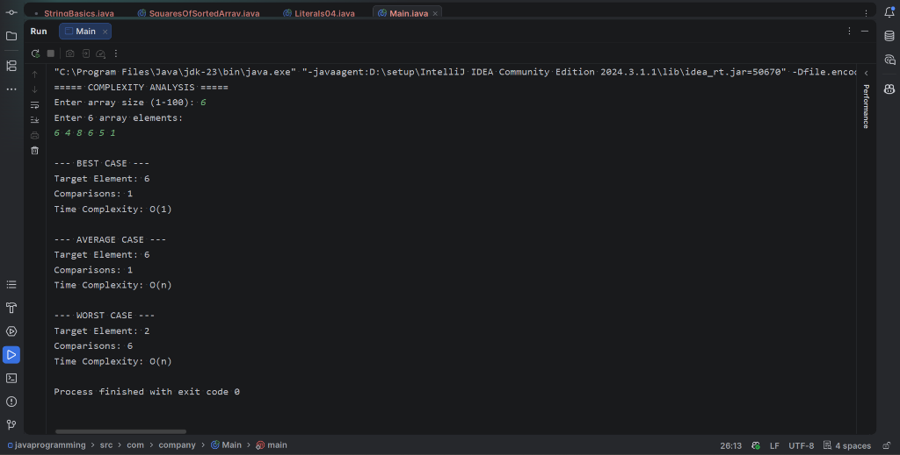

# 04 - Complexity Analysis

## 1. Problem Statement
Implement a Java program to empirically analyze the time complexity of the Linear Search algorithm across its three operational scenarios:
- **Best Case**: Target element is at the very first position.
- **Average Case**: Target element is positioned around the middle of the array.
- **Worst Case**: Target element is absent from the array or located at the final index.

The program counts and displays the exact number of key comparisons performed in each case and relates them to their asymptotic notations.

---

## 2. Approach
1. **Instrumented Search Function (`linearSearch`)**:
   - Takes array `arr`, active `size`, `target`, and a single-element reference array `comparisons` used as a mutable counter.
   - Iterates from index `0` to `size - 1`, incrementing `comparisons[0]` at each step before testing equality (`arr[i] == target`).
   - Returns the index upon finding a match, or `-1` if the loop terminates without finding the target.
2. **Scenario Formulation**:
   - **Best Case Setup**: Select `arr[0]` as target. The loop exits on the very first comparison ($C = 1 \implies \mathcal{O}(1)$).
   - **Average Case Setup**: Select middle element `arr[size / 2]` as target. Search traverses approximately $\frac{n}{2}$ elements before match ($C \approx \frac{n}{2} \implies \mathcal{O}(n)$).
   - **Worst Case Setup**: Formulate a target value guaranteed to be absent (e.g., modified value of `arr[size - 1]`). The search inspects every element ($C = n \implies \mathcal{O}(n)$).

---

## 3. Pseudocode

```text
Algorithm: LinearSearchWithCounter(arr, size, target, comparisons)
Input: Array arr, integer size, target key, comparisons counter
Output: Index of target if found, else -1

comparisons <- 0

For i <- 0 to size - 1 Do:
    comparisons <- comparisons + 1
    If arr[i] == target Then:
        Return i

Return -1
```

---

## 4. Time & Space Complexity Analysis

| Case | Mathematical Condition | Number of Comparisons | Asymptotic Notation |
| :--- | :--- | :---: | :---: |
| **Best Case** | Target found at index `0` | $1$ | $\mathcal{O}(1)$ |
| **Average Case** | Target found at index `k` ($0 \le k < n$) | $\frac{n + 1}{2}$ | $\mathcal{O}(n)$ |
| **Worst Case** | Target is absent or at index `n - 1` | $n$ | $\mathcal{O}(n)$ |

- **Auxiliary Space Complexity**: $\mathcal{O}(1)$ auxiliary memory (only integer pointers and counters).

---

## 5. Sample Input & Output

### Input
```text
Enter array size (1-100): 6
Enter 6 array elements:
6 4 8 6 5 1
```

### Output
```text
--- BEST CASE ---
Target Element: 6
Comparisons: 1
Time Complexity: O(1)

--- AVERAGE CASE ---
Target Element: 6
Comparisons: 1
Time Complexity: O(n)

--- WORST CASE ---
Target Element: 2
Comparisons: 6
Time Complexity: O(n)
```

---

## 6. Output Screenshot



---

## 7. Learning Outcomes
- Demonstrated how empirical operation counting directly validates theoretical Big-$\mathcal{O}$ asymptotic bounds.
- Understood why the Best Case of linear search runs in constant time $\mathcal{O}(1)$ regardless of array size $n$.
- Verified that Worst and Average cases scale linearly $\mathcal{O}(n)$ with the input size $n$.
- Experienced instrumentation of algorithms for performance profiling and benchmarking.
