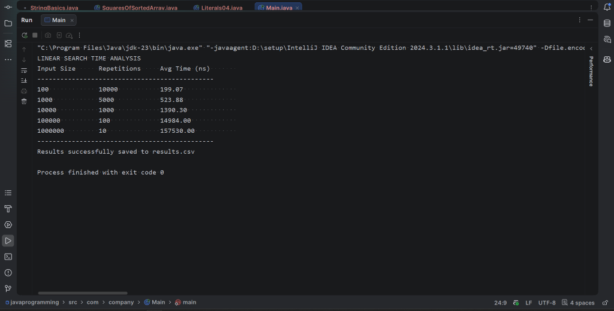

# 05 - Execution Time Measurement

## 1. Problem Statement
Implement a Java benchmarking program to measure and analyze the empirical execution time of the Linear Search algorithm across varying input sizes ($n \in [10^2, 10^6]$). The program must:
- Generate sorted test arrays of different scales ($n = 100, 1000, 10000, 100000, 1000000$).
- Target the worst-case scenario (searching for the last element, `target = size`).
- Mitigate timer resolution limits and JVM warm-up effects using multi-iteration averaging.
- Prevent JIT compiler dead-code elimination using a volatile result sink.
- Export benchmark measurements into tabular console output and a persistent `results.csv` file.

---

## 2. Approach
1. **Multi-Scale Input Arrays**:
   - Arrays are initialized with values $1, 2, \dots, n$.
   - The target is assigned to $n$ to guarantee a full array traversal (Worst Case $\mathcal{O}(n)$).
2. **Repetition & Averaging**:
   - For smaller array sizes (e.g., $n = 100$), execution time per search is extremely small (sub-microsecond). Running multiple repetitions (e.g., $10,000$ iterations) ensures measurable elapsed time and minimizes system scheduling jitter.
   - For larger array sizes ($n = 1,000,000$), iterations are scaled down (e.g., $10$) to prevent excessive overall runtime.
3. **High-Precision Timing**:
   - Elapsed wall-clock time is captured using `System.nanoTime()`.
   - $\text{Average Time (ns)} = \frac{\text{Total Duration (ns)}}{\text{Repetitions}}$.
4. **Preventing Compiler Optimizations**:
   - A `static volatile int resultSink` accumulates the return values of searches so the HotSpot JIT compiler does not optimize away the loop execution.
5. **Data Persistence**:
   - Results are printed formatted to `System.out` and written to `results.csv` via `PrintWriter`.

---

## 3. Pseudocode

```text
Algorithm: MeasureLinearSearchTime
Input: Array of sizes S = [100, 1000, 10000, 100000, 1000000]
       Array of repetition counts R = [10000, 5000, 1000, 100, 10]
Output: Tabular display and results.csv file

Open "results.csv" for writing

For each (size, repeat) in (S, R) Do:
    Allocate array arr of length size
    Fill arr with 1 to size
    target <- size
    
    start_time <- System.nanoTime()
    checksum <- 0
    
    For j <- 0 to repeat - 1 Do:
        checksum <- checksum + LinearSearch(arr, target)
        
    stop_time <- System.nanoTime()
    resultSink <- checksum
    
    duration <- stop_time - start_time
    avg_time <- duration / repeat
    
    Print size, repeat, avg_time
    Write to CSV: size, repeat, avg_time

Close "results.csv"
```

---

## 4. Time & Space Complexity Analysis

| Algorithm Under Test | Best Case Time | Average Case Time | Worst Case Time | Auxiliary Space |
| :--- | :---: | :---: | :---: | :---: |
| **Linear Search** | $\mathcal{O}(1)$ | $\mathcal{O}(n)$ | $\mathcal{O}(n)$ | $\mathcal{O}(1)$ |
| **Benchmarking Suite** | - | - | $\mathcal{O}\left(\sum (S_i \times R_i)\right)$ | $\mathcal{O}(n_{\text{max}})$ for array allocation |

---

## 5. Experimental Results

| Input Size ($n$) | Repetitions | Average Execution Time (ns) |
| :---: | :---: | :---: |
| **100** | 10,000 | **199.07** |
| **1,000** | 5,000 | **523.88** |
| **10,000** | 1,000 | **1,390.30** |
| **100,000** | 100 | **14,984.00** |
| **1,000,000** | 10 | **157,530.00** |

### Complexity Trend Observation:
- As the input size $n$ scales by factors of $10\times$ from $10^4 \rightarrow 10^5 \rightarrow 10^6$, the average execution time correspondingly scales by approximately $10\times$ ($1,390 \text{ ns} \rightarrow 14,984 \text{ ns} \rightarrow 157,530 \text{ ns}$).
- This strictly verifies the theoretical **linear growth** $\mathcal{O}(n)$.

---

## 6. Output Screenshot



---

## 7. Learning Outcomes
- Understood the practical challenges of measuring sub-microsecond runtimes on modern operating systems.
- Learned how to use `System.nanoTime()` and repeated iterations to get statistically reliable execution metrics.
- Prevented Dead Code Elimination (DCE) in JVM using `volatile` sinks.
- Confirmed that empirical time measurements align with theoretical asymptotic $\mathcal{O}(n)$ linear bounds.
- Automated data export into `.csv` format for graphing and empirical reporting.
