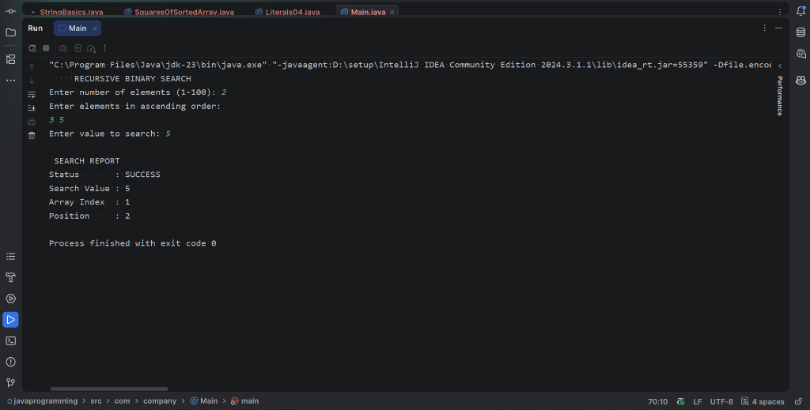

# 01 - Binary Search (Divide and Conquer)

## 1. Problem Statement
Implement a recursive Binary Search algorithm in Java using the **Divide and Conquer** paradigm. The program must:
- Accept a pre-sorted array of integers within a constrained size range ($1 \le n \le 100$).
- Enforce strict input validation to verify ascending sorted order.
- Search for a user-specified key by recursively dividing the search domain.
- Produce a structured search report detailing status, 0-based array index, and 1-based human position.

---

## 2. Algorithm / Approach
The algorithm decomposes the searching problem into smaller subproblems following the **Divide and Conquer** methodology:

1. **Divide**:
   - Compute the midpoint of the active search range:
     $$\text{middle} = \text{left} + \frac{\text{right} - \text{left}}{2}$$
   - This divides the current search interval into two equal halves while preventing 32-bit integer overflow.
2. **Conquer (Base Cases)**:
   - **Target Match**: If `numbers[middle] == key`, return `middle`.
   - **Exhaustion**: If `left > right`, the search window is invalid; return `-1` (element not found).
3. **Combine / Recurse**:
   - If `numbers[middle] < key`: The key must lie strictly in the right half. Recurse on `search(numbers, middle + 1, right, key)`.
   - If `numbers[middle] > key`: The key must lie strictly in the left half. Recurse on `search(numbers, left, middle - 1, key)`.

### Recurrence Relation:
$$T(n) = T\left(\frac{n}{2}\right) + \mathcal{O}(1)$$
Using the Master Theorem ($a = 1, b = 2, f(n) = \mathcal{O}(1)$):
$$\log_b a = \log_2 1 = 0 \implies f(n) = \Theta(n^0) \implies T(n) = \Theta(\log n)$$

---

## 3. Pseudocode

```text
Algorithm: BinarySearch_DC(numbers, left, right, key)
Input: Sorted array numbers, interval bounds left and right, target key
Output: Index of key if found, else -1

If left > right Then:
    Return -1

middle <- left + (right - left) / 2

If numbers[middle] == key Then:
    Return middle
Else If numbers[middle] < key Then:
    Return BinarySearch_DC(numbers, middle + 1, right, key)
Else:
    Return BinarySearch_DC(numbers, left, middle - 1, key)
```

---

## 4. Time & Space Complexity Analysis

| Case | Recurrence / Condition | Complexity | Explanation |
| :--- | :--- | :---: | :--- |
| **Best Case** | $\text{numbers}[\text{middle}] == \text{key}$ on 1st step | $\mathcal{O}(1)$ | Target found at midpoint of the root call. |
| **Average Case** | $T(n) = T(n/2) + \mathcal{O}(1)$ | $\mathcal{O}(\log n)$ | Interval is bisected at each recursive level. |
| **Worst Case** | Target at extreme or not present | $\mathcal{O}(\log n)$ | Traverses maximum depth $\lfloor\log_2 n\rfloor + 1$. |
| **Auxiliary Space** | Call stack height | $\mathcal{O}(\log n)$ | Recursion stack frames created per level of division. |

---

## 5. Sample Input & Output

### Input
```text
Enter number of elements (1-100): 2
Enter elements in ascending order:
3 5
Enter value to search: 5
```

### Output
```text
 SEARCH REPORT
Status       : SUCCESS
Search Value : 5
Array Index  : 1
Position     : 2
```

---

## 6. Output Screenshot



---

## 7. Learning Outcomes
- Formalized how the Divide and Conquer strategy applies to logarithmic search reduction.
- Derived and solved recurrence relation $T(n) = T(n/2) + \mathcal{O}(1)$ using Master Theorem.
- Implemented ascending sorted-order validation at input time.
- Observed the difference between 0-based array indexing and 1-based user positions.
- Evaluated call stack overhead ($\mathcal{O}(\log n)$ auxiliary space) associated with recursive divide-and-conquer execution.
