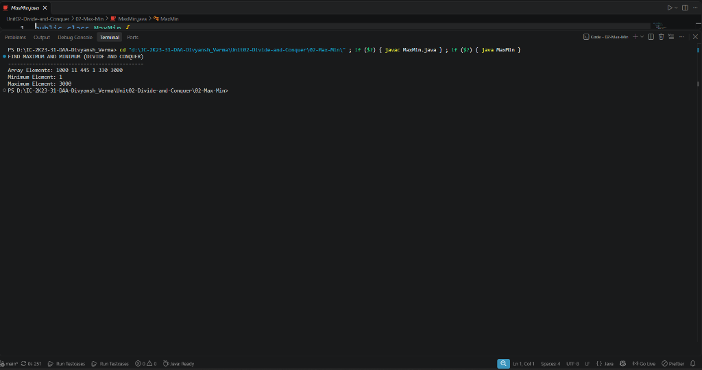

# 02 - Maximum and Minimum (Divide and Conquer)

## 1. Aim / Objective
Implement the Divide and Conquer algorithm in Java to locate the maximum and minimum elements in an array simultaneously, optimizing the total number of element comparisons compared to the naive linear search approach.

---

## 2. Algorithm Overview
The Divide and Conquer approach finds both the minimum and maximum by recursively dividing the array into two halves, finding the maximum and minimum for both halves independently, and then combining the results using two comparisons.

For an array of size $n$, the recurrence relation for the number of comparisons $T(n)$ is:
$$T(n) = \begin{cases} 0 & \text{if } n = 1 \\ 1 & \text{if } n = 2 \\ 2T\left(\frac{n}{2}\right) + 2 & \text{if } n > 2 \end{cases}$$

When $n$ is a power of 2, this yields:
$$T(n) = \frac{3n}{2} - 2 \text{ comparisons}$$
This represents a $\approx 25\%$ reduction compared to naive linear scanning which requires $2n - 2$ comparisons in the worst case.

---

## 3. Approach Used
1. **Base Case 1 ($n = 1$)**: When `low == high`, the subarray has only one element. Return `Result(array[low], array[low])` with 0 comparisons.
2. **Base Case 2 ($n = 2$)**: When `high == low + 1`, compare the two elements directly using 1 comparison. Return `Result(min, max)`.
3. **Divide Step**: When $n > 2$, compute the midpoint `mid = low + (high - low) / 2`.
4. **Conquer Step**: Recursively find the min and max of:
   - Left half: `findMaxMin(array, low, mid)`
   - Right half: `findMaxMin(array, mid + 1, high)`
5. **Combine Step**:
   - `overallMin = Math.min(leftResult.min, rightResult.min)` (1 comparison)
   - `overallMax = Math.max(leftResult.max, rightResult.max)` (1 comparison)

---

## 4. Java Implementation
The complete implementation is maintained in [`MaxMin.java`](MaxMin.java).

```java
public class MaxMin {

    static class Result {
        int min;
        int max;

        Result(int min, int max) {
            this.min = min;
            this.max = max;
        }
    }

    public static Result findMaxMin(int[] array, int low, int high) {
        if (low == high) {
            return new Result(array[low], array[low]);
        }

        if (high == low + 1) {
            if (array[low] < array[high]) {
                return new Result(array[low], array[high]);
            } else {
                return new Result(array[high], array[low]);
            }
        }

        int mid = low + (high - low) / 2;

        Result leftResult = findMaxMin(array, low, mid);
        Result rightResult = findMaxMin(array, mid + 1, high);

        int overallMin = Math.min(leftResult.min, rightResult.min);
        int overallMax = Math.max(leftResult.max, rightResult.max);

        return new Result(overallMin, overallMax);
    }
...
```

---

## 5. Sample Input & Output

### Input
- **Array**: `[1000, 11, 445, 1, 330, 3000]`
- **Array Size**: `6`

### Output
```text
FIND MAXIMUM AND MINIMUM (DIVIDE AND CONQUER)
---------------------------------------------
Array Elements: 1000 11 445 1 330 3000 
Minimum Element: 1
Maximum Element: 3000
```

---

## 6. Output Screenshot



---

## 7. Time & Space Complexity

| Metric | Complexity | Explanation |
| :--- | :---: | :--- |
| **Best Case Time** | $\mathcal{O}(n)$ | Performs exactly $\frac{3n}{2} - 2$ element comparisons. |
| **Average Case Time** | $\mathcal{O}(n)$ | Recursive divide and conquer bisection on both halves. |
| **Worst Case Time** | $\mathcal{O}(n)$ | Maximum $\frac{3n}{2} - 2$ comparisons, strictly better than naive $2n - 2$. |
| **Auxiliary Space** | $\mathcal{O}(\log n)$ | Space required for recursive call stack frames ($\lceil\log_2 n\rceil$). |

---

## 8. Key Learning Outcomes
- Understood how the Divide and Conquer strategy reduces the coefficient of comparison complexity from $2n$ to $\frac{3n}{2}$.
- Formulated and solved the recurrence relation $T(n) = 2T(n/2) + 2$.
- Learned to handle base cases for both odd and even length subarrays ($n = 1$ and $n = 2$).
- Verified that returning a composite `Result` object avoids redundant traversals.
