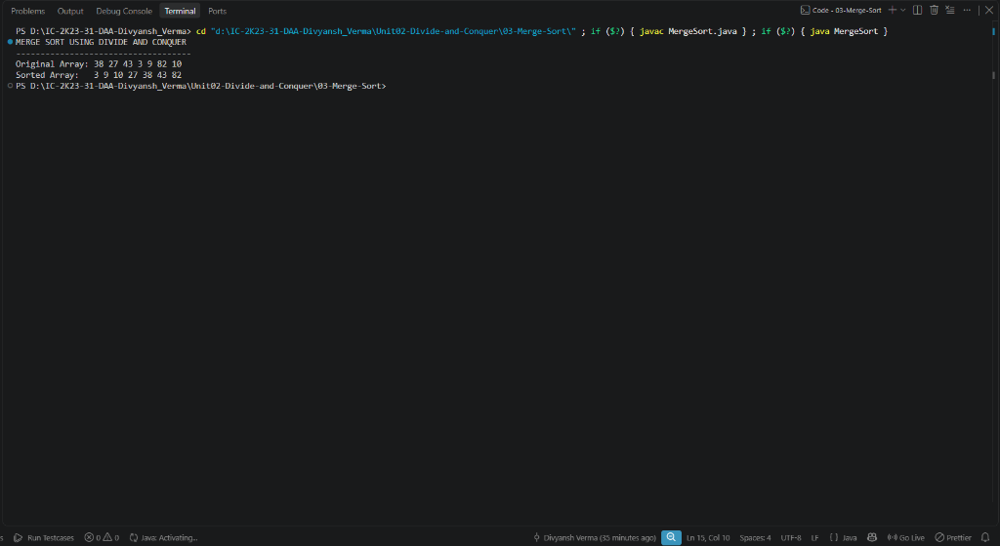

# 03 - Merge Sort (Divide and Conquer)

## 1. Aim / Objective
Implement the Merge Sort algorithm in Java using the Divide and Conquer strategy to sort an array of integers in ascending order with guaranteed $\mathcal{O}(n \log n)$ time complexity.

---

## 2. Algorithm Overview
Merge Sort is a classic recursive divide-and-conquer comparison-based sorting algorithm:
1. **Divide**: Bisect the array of size $n$ into two equal (or near-equal) sub-arrays of size $\lfloor n/2 \rfloor$ and $\lceil n/2 \rceil$.
2. **Conquer**: Recursively sort both sub-arrays using `mergeSort`.
3. **Combine**: Merge the two sorted sub-arrays into a single sorted array using a linear two-pointer merge subroutine.

### Recurrence Relation:
$$T(n) = 2T\left(\frac{n}{2}\right) + \Theta(n)$$
By Case 2 of the Master Theorem ($a = 2, b = 2, f(n) = \Theta(n)$ where $\log_b a = 1$):
$$T(n) = \Theta(n \log n)$$

---

## 3. Approach Used
- **Recursive Splitting**: Midpoint computed safely as `mid = left + (right - left) / 2`.
- **Base Case**: Recursion halts when `left >= right` (single-element or empty subarray).
- **Two-Pointer Merge (`merge`)**:
  - Temporary arrays `leftArray` and `rightArray` store the two halves.
  - Three pointers `i`, `j`, and `k` track positions in the left half, right half, and original array respectively.
  - Sequentially copy smaller elements to `array[k]`.
  - Append any remaining elements from either subarray.

---

## 4. Java Implementation
The complete implementation is maintained in [`MergeSort.java`](MergeSort.java).

```java
public class MergeSort {

    public static void merge(int[] array, int left, int mid, int right) {
        int n1 = mid - left + 1;
        int n2 = right - mid;

        int[] leftArray = new int[n1];
        int[] rightArray = new int[n2];

        for (int i = 0; i < n1; i++) {
            leftArray[i] = array[left + i];
        }
        for (int j = 0; j < n2; j++) {
            rightArray[j] = array[mid + 1 + j];
        }

        int i = 0;
        int j = 0;
        int k = left;

        while (i < n1 && j < n2) {
            if (leftArray[i] <= rightArray[j]) {
                array[k] = leftArray[i];
                i++;
            } else {
                array[k] = rightArray[j];
                j++;
            }
            k++;
        }

        while (i < n1) {
            array[k] = leftArray[i];
            i++;
            k++;
        }

        while (j < n2) {
            array[k] = rightArray[j];
            j++;
            k++;
        }
    }

    public static void mergeSort(int[] array, int left, int right) {
        if (left < right) {
            int mid = left + (right - left) / 2;

            mergeSort(array, left, mid);
            mergeSort(array, mid + 1, right);

            merge(array, left, mid, right);
        }
    }
...
```

---

## 5. Sample Input & Output

### Input
- **Original Array**: `[38, 27, 43, 3, 9, 82, 10]`

### Output
```text
MERGE SORT USING DIVIDE AND CONQUER
------------------------------------
Original Array: 38 27 43 3 9 82 10 
Sorted Array:   3 9 10 27 38 43 82 
```

---

## 6. Output Screenshot



---

## 7. Time & Space Complexity

| Metric | Complexity | Explanation |
| :--- | :---: | :--- |
| **Best Case Time** | $\mathcal{O}(n \log n)$ | Divides into $\log_2 n$ levels, performing $\mathcal{O}(n)$ merges per level. |
| **Average Case Time** | $\mathcal{O}(n \log n)$ | Independent of initial element ordering. |
| **Worst Case Time** | $\mathcal{O}(n \log n)$ | Always bisects and merges in linear time. |
| **Auxiliary Space** | $\mathcal{O}(n)$ | Requires temporary buffer arrays for merging ($\mathcal{O}(n)$) + call stack ($\mathcal{O}(\log n)$). |

---

## 8. Key Learning Outcomes
- Mastered the Divide and Conquer framework applied to sorting algorithms.
- Solved and verified the recurrence relation $T(n) = 2T(n/2) + \Theta(n)$ via Master Theorem.
- Observed that Merge Sort provides **stable sorting** with consistent $\mathcal{O}(n \log n)$ performance across all input distributions.
- Understood the trade-off of $\mathcal{O}(n)$ auxiliary memory allocation compared to in-place algorithms like Quick Sort.
