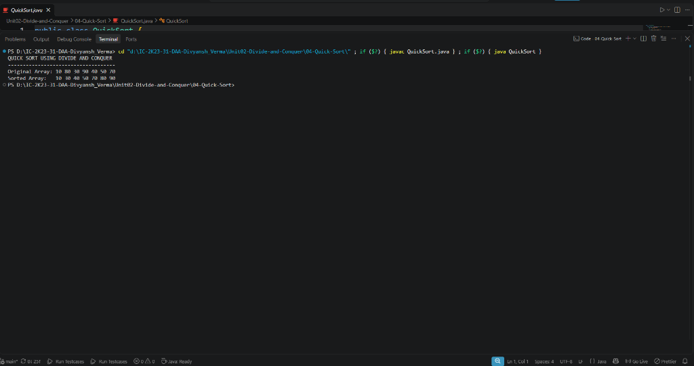

# 04 - Quick Sort (Divide and Conquer)

## 1. Aim / Objective
Implement the Quick Sort algorithm in Java using the Divide and Conquer strategy, utilizing partition-based pivot placement to sort an integer array in-place.

---

## 2. Algorithm Overview
Quick Sort is an efficient, in-place, divide-and-conquer sorting algorithm based on the concept of partitioning:
1. **Pivot Selection**: Select an element as the pivot (the implementation uses the last element `array[high]`).
2. **Partitioning**: Rearrange the array such that all elements less than or equal to the pivot are placed to its left, and all greater elements to its right. The pivot is placed at its final sorted position `pivotIndex`.
3. **Recursive Sorting**: Recursively apply Quick Sort to the left subarray (`low` to `pivotIndex - 1`) and right subarray (`pivotIndex + 1` to `high`).

### Recurrence Relations:
- **Best / Balanced Partition**:
  $$T(n) = 2T\left(\frac{n}{2}\right) + \Theta(n) \implies \Theta(n \log n)$$
- **Worst-Case Partition (Unbalanced, e.g., already sorted)**:
  $$T(n) = T(n - 1) + \Theta(n) \implies \Theta(n^2)$$

---

## 3. Approach Used
- **Lomuto Partition Scheme (`partition`)**:
  - `pivot = array[high]`
  - Index `i = low - 1` tracks the boundary of elements smaller than the pivot.
  - Index `j` traverses from `low` to `high - 1`. Whenever `array[j] <= pivot`, increment `i` and swap `array[i]` with `array[j]`.
  - Finally, swap `array[i + 1]` with `array[high]` to put the pivot in place, and return `i + 1`.
- **Recursive Sort (`quickSort`)**:
  - Continues while `low < high`.
  - Bypasses auxiliary buffer arrays, sorting directly **in-place**.

---

## 4. Java Implementation
The complete implementation is maintained in [`QuickSort.java`](QuickSort.java).

```java
public class QuickSort {

    public static int partition(int[] array, int low, int high) {
        int pivot = array[high];
        int i = low - 1;

        for (int j = low; j < high; j++) {
            if (array[j] <= pivot) {
                i++;
                int temp = array[i];
                array[i] = array[j];
                array[j] = temp;
            }
        }

        int temp = array[i + 1];
        array[i + 1] = array[high];
        array[high] = temp;

        return i + 1;
    }

    public static void quickSort(int[] array, int low, int high) {
        if (low < high) {
            int pivotIndex = partition(array, low, high);

            quickSort(array, low, pivotIndex - 1);
            quickSort(array, pivotIndex + 1, high);
        }
    }
...
```

---

## 5. Sample Input & Output

### Input
- **Original Array**: `[10, 80, 30, 90, 40, 50, 70]`

### Output
```text
QUICK SORT USING DIVIDE AND CONQUER
------------------------------------
Original Array: 10 80 30 90 40 50 70 
Sorted Array:   10 30 40 50 70 80 90 
```

---

## 6. Output Screenshot



---

## 7. Time & Space Complexity

| Metric | Complexity | Explanation |
| :--- | :---: | :--- |
| **Best Case Time** | $\mathcal{O}(n \log n)$ | Partition splits array into two nearly equal halves at each step. |
| **Average Case Time** | $\mathcal{O}(n \log n)$ | Randomized/typical inputs achieve logarithmic depth with linear partition passes. |
| **Worst Case Time** | $\mathcal{O}(n^2)$ | Occurs when pivot is consistently the smallest or largest element. |
| **Auxiliary Space** | $\mathcal{O}(\log n)$ | In-place sorting; stack space required for recursive calls ($\mathcal{O}(n)$ in worst case). |

---

## 8. Key Learning Outcomes
- Mastered in-place array partitioning using the Lomuto partition technique.
- Understood why Quick Sort has smaller constant factors than Merge Sort despite identical $\mathcal{O}(n \log n)$ average complexity.
- Identified the conditions that trigger worst-case $\mathcal{O}(n^2)$ performance and how pivot selection influences partition balance.
- Contrasted space trade-offs between Quick Sort (in-place, $\mathcal{O}(\log n)$ stack) and Merge Sort ($\mathcal{O}(n)$ memory).
