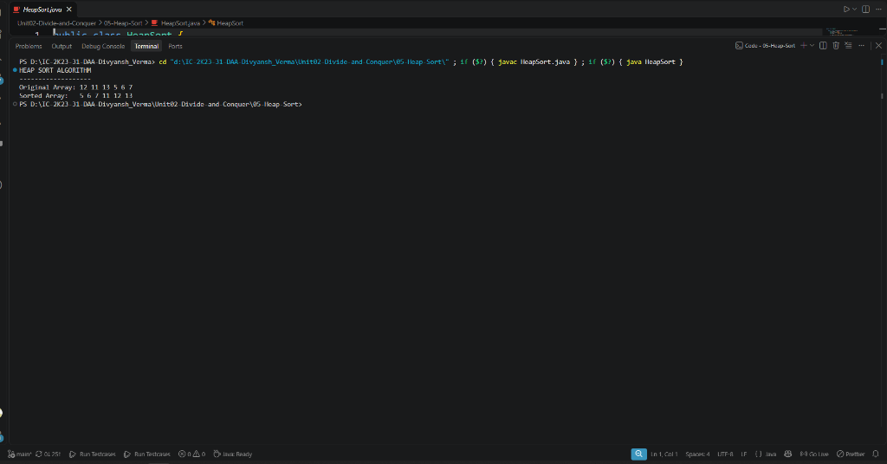

# 05 - Heap Sort

## 1. Aim / Objective
Implement the Heap Sort algorithm in Java using a Binary Max-Heap data structure to sort an integer array in ascending order with guaranteed $\mathcal{O}(n \log n)$ time complexity and strictly $\mathcal{O}(1)$ auxiliary space.

---

## 2. Algorithm Overview
Heap Sort utilizes the properties of a complete binary tree structured as a **Max-Heap**, where the key of every parent node is greater than or equal to the keys of its children ($A[\text{parent}] \ge A[\text{child}]$):
1. **Build Max-Heap**: Transform the unsorted array into a max-heap in linear time $\mathcal{O}(n)$ starting from the last non-leaf node $\lfloor n/2 \rfloor - 1$ down to the root index $0$.
2. **Repeated Root Extraction**:
   - The largest element resides at root index $0$.
   - Swap the root with the last element of the heap (index $i$).
   - Reduce the active heap size by 1.
   - Restore the max-heap property at the root using `heapify(array, i, 0)`.
3. Repeat step 2 until the active heap size diminishes to 1, leaving the array completely sorted.

---

## 3. Approach Used
- **Index Relations (0-based)**:
  - Left Child: $2i + 1$
  - Right Child: $2i + 2$
  - Parent: $\lfloor (i - 1) / 2 \rfloor$
- **Subroutine `heapify(array, size, index)`**:
  - Compares node `index` with its left and right children.
  - If a child holds a strictly greater value, identifies the `largest` and swaps values.
  - Recursively heapifies the affected subtree to preserve heap integrity.
- **Phase 1 (Heap Construction)**:
  - Invokes `heapify` for $i = \lfloor \text{size}/2 \rfloor - 1$ down to $0$.
- **Phase 2 (Sorting)**:
  - For $i = \text{size} - 1$ down to $1$, swaps `array[0]` with `array[i]` and calls `heapify(array, i, 0)`.

---

## 4. Java Implementation
The complete implementation is maintained in [`HeapSort.java`](HeapSort.java).

```java
public class HeapSort {

    public static void heapify(int[] array, int size, int index) {
        int largest = index;
        int left = 2 * index + 1;
        int right = 2 * index + 2;

        if (left < size && array[left] > array[largest]) {
            largest = left;
        }

        if (right < size && array[right] > array[largest]) {
            largest = right;
        }

        if (largest != index) {
            int swap = array[index];
            array[index] = array[largest];
            array[largest] = swap;

            heapify(array, size, largest);
        }
    }

    public static void heapSort(int[] array) {
        int size = array.length;

        for (int i = size / 2 - 1; i >= 0; i--) {
            heapify(array, size, i);
        }

        for (int i = size - 1; i > 0; i--) {
            int temp = array[0];
            array[0] = array[i];
            array[i] = temp;

            heapify(array, i, 0);
        }
    }
...
```

---

## 5. Sample Input & Output

### Input
- **Original Array**: `[12, 11, 13, 5, 6, 7]`

### Output
```text
HEAP SORT ALGORITHM
-------------------
Original Array: 12 11 13 5 6 7 
Sorted Array:   5 6 7 11 12 13 
```

---

## 6. Output Screenshot



---

## 7. Time & Space Complexity

| Metric | Complexity | Explanation |
| :--- | :---: | :--- |
| **Best Case Time** | $\mathcal{O}(n \log n)$ | Building heap takes $\mathcal{O}(n)$, followed by $n-1$ extractions each costing $\mathcal{O}(\log n)$. |
| **Average Case Time** | $\mathcal{O}(n \log n)$ | Consistently traverses the logarithmic height of the complete binary tree. |
| **Worst Case Time** | $\mathcal{O}(n \log n)$ | Guaranteed asymptotic upper bound; immune to Quick Sort's $\mathcal{O}(n^2)$ worst-case degradation. |
| **Auxiliary Space** | $\mathcal{O}(1)$ | Operates directly within the input array (**in-place**). |

---

## 8. Key Learning Outcomes
- Understood implicit array representation of complete binary trees without pointers.
- Learned that building a heap from an arbitrary array takes linear time $\mathcal{O}(n)$, not $\mathcal{O}(n \log n)$.
- Observed that Heap Sort combines the best aspects of Merge Sort (guaranteed $\mathcal{O}(n \log n)$) and Quick Sort (minimal in-place memory).
- Noted that Heap Sort is **unstable** due to root swaps jumping across distant array positions.
