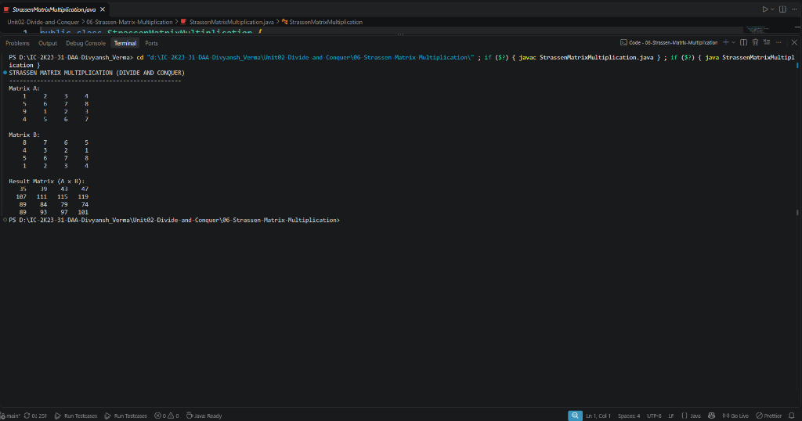

# Lab 06: Strassen's Matrix Multiplication

## 1. Lab Title
**Strassen's Matrix Multiplication using Divide and Conquer Strategy**

---

## 2. Aim / Objective
To design, implement, and analyze Strassen's Matrix Multiplication algorithm using the Divide and Conquer approach in Java, and demonstrate how it reduces the number of recursive scalar multiplications from 8 down to 7 to achieve sub-cubic asymptotic time complexity.

---

## 3. Algorithm Overview
The standard matrix multiplication algorithm for two $n \times n$ matrices requires $n^3$ multiplications, resulting in $\mathcal{O}(n^3)$ running time. Volker Strassen (1969) discovered that matrix multiplication can be computed faster by reducing the 8 recursive multiplications of submatrices of size $(n/2) \times (n/2)$ to only 7 recursive multiplications, at the expense of several extra matrix additions and subtractions.

Given two matrices partitioned into four submatrices:
$$A = \begin{pmatrix} A_{11} & A_{12} \\ A_{21} & A_{22} \end{pmatrix}, \quad B = \begin{pmatrix} B_{11} & B_{12} \\ B_{21} & B_{22} \end{pmatrix}$$

Strassen defines 7 auxiliary matrices $M_1$ through $M_7$:
1. $M_1 = (A_{11} + A_{22}) \times (B_{11} + B_{22})$
2. $M_2 = (A_{21} + A_{22}) \times B_{11}$
3. $M_3 = A_{11} \times (B_{12} - B_{22})$
4. $M_4 = A_{22} \times (B_{21} - B_{11})$
5. $M_5 = (A_{11} + A_{12}) \times B_{22}$
6. $M_6 = (A_{21} - A_{11}) \times (B_{11} + B_{12})$
7. $M_7 = (A_{12} - A_{22}) \times (B_{21} + B_{22})$

The quadrants of the resultant matrix $C = A \times B$ are formed as:
- $C_{11} = M_1 + M_4 - M_5 + M_7$
- $C_{12} = M_3 + M_5$
- $C_{21} = M_2 + M_4$
- $C_{22} = M_1 - M_2 + M_3 + M_6$

---

## 4. Approach Used
1. **Divide:** Recursively partition the input square matrices $A$ and $B$ (where $n$ is a power of 2) into four $(n/2) \times (n/2)$ submatrices using helper method `split()`.
2. **Conquer:** Calculate the 7 intermediate matrix products $M_1$ to $M_7$ recursively by multiplying sums and differences of submatrices.
3. **Combine:** Assemble the final quadrant matrices $C_{11}, C_{12}, C_{21}, C_{22}$ using addition and subtraction, and combine them into the complete resultant matrix using helper method `join()`.
4. **Base Case:** When matrix size reduces to $1 \times 1$, directly multiply the single elements ($result[0][0] = A[0][0] \times B[0][0]$).

---

## 5. Java Implementation
The complete source code is available in [`StrassenMatrixMultiplication.java`](StrassenMatrixMultiplication.java).

```java
// Core recursive Strassen multiplication logic:
public static int[][] multiply(int[][] A, int[][] B) {
    int n = A.length;
    int[][] result = new int[n][n];

    if (n == 1) {
        result[0][0] = A[0][0] * B[0][0];
        return result;
    }

    int newSize = n / 2;
    int[][] a11 = new int[newSize][newSize];
    int[][] a12 = new int[newSize][newSize];
    int[][] a21 = new int[newSize][newSize];
    int[][] a22 = new int[newSize][newSize];

    int[][] b11 = new int[newSize][newSize];
    int[][] b12 = new int[newSize][newSize];
    int[][] b21 = new int[newSize][newSize];
    int[][] b22 = new int[newSize][newSize];

    split(A, a11, 0, 0);
    split(A, a12, 0, newSize);
    split(A, a21, newSize, 0);
    split(A, a22, newSize, newSize);

    split(B, b11, 0, 0);
    split(B, b12, 0, newSize);
    split(B, b21, newSize, 0);
    split(B, b22, newSize, newSize);

    int[][] m1 = multiply(add(a11, a22), add(b11, b22));
    int[][] m2 = multiply(add(a21, a22), b11);
    int[][] m3 = multiply(a11, subtract(b12, b22));
    int[][] m4 = multiply(a22, subtract(b21, b11));
    int[][] m5 = multiply(add(a11, a12), b22);
    int[][] m6 = multiply(subtract(a21, a11), add(b11, b12));
    int[][] m7 = multiply(subtract(a12, a22), add(b21, b22));

    int[][] c11 = add(subtract(add(m1, m4), m5), m7);
    int[][] c12 = add(m3, m5);
    int[][] c21 = add(m2, m4);
    int[][] c22 = add(subtract(add(m1, m3), m2), m6);

    join(c11, result, 0, 0);
    join(c12, result, 0, newSize);
    join(c21, result, newSize, 0);
    join(c22, result, newSize, newSize);

    return result;
}
```

---

## 6. Sample Input
Two $4 \times 4$ integer matrices:
```text
Matrix A:
    1     2     3     4 
    5     6     7     8 
    9     1     2     3 
    4     5     6     7 

Matrix B:
    8     7     6     5 
    4     3     2     1 
    5     6     7     8 
    1     2     3     4 
```

---

## 7. Sample Output
```text
STRASSEN MATRIX MULTIPLICATION (DIVIDE AND CONQUER)
--------------------------------------------------
Matrix A:
    1     2     3     4 
    5     6     7     8 
    9     1     2     3 
    4     5     6     7 

Matrix B:
    8     7     6     5 
    4     3     2     1 
    5     6     7     8 
    1     2     3     4 

Result Matrix (A x B):
   35    39    43    47 
  107   111   115   119 
   89    84    79    74 
   89    93    97   101 
```

---

## 8. Output Screenshots


---

## 9. Time Complexity
- **Recurrence Relation:**
  $$T(n) = 7 T(n/2) + \Theta(n^2)$$
  where $\Theta(n^2)$ accounts for matrix additions and subtractions.
- **Using Master Theorem:**
  - $a = 7$, $b = 2$, $f(n) = \Theta(n^2)$
  - Critical exponent $\log_b a = \log_2 7 \approx 2.8074$
  - Since $f(n) = \mathcal{O}(n^{\log_2 7 - \epsilon})$, Case 1 of Master Theorem applies:
  $$T(n) = \Theta(n^{\log_2 7}) \approx \Theta(n^{2.807})$$
- **Comparison:**
  - Standard Multiplication: $\mathcal{O}(n^3)$
  - Strassen's Multiplication: $\mathcal{O}(n^{2.807})$ (sub-cubic complexity)

---

## 10. Space Complexity
- Auxiliary Space: $\mathcal{O}(n^2)$ to store the submatrices at each recursion depth.
- Recursion Stack Depth: $\mathcal{O}(\log n)$.
- Total Space Complexity: $\mathcal{O}(n^2)$.

---

## 11. Key Learning Outcomes
- Understood how algebraic manipulation can trade high-cost recursive multiplications for lower-cost additions/subtractions.
- Observed how the Master Theorem rigorously evaluates divide-and-conquer recurrences with non-integer exponents.
- Learned the practical trade-offs: while Strassen has lower asymptotic complexity for huge matrices, standard multiplication is typically faster for small matrices due to lower constant factors and recursion overhead.
