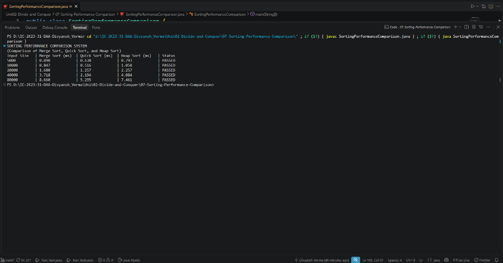

# Lab 07: Sorting Performance Comparison

## 1. Lab Title
**Empirical Performance Comparison of Merge Sort, Quick Sort, and Heap Sort**

---

## 2. Aim / Objective
To implement an automated benchmarking harness in Java that experimentally measures, validates, and compares the execution times of three $\mathcal{O}(n \log n)$ sorting algorithms—**Merge Sort**, **Quick Sort**, and **Heap Sort**—across varying input sizes (5,000 to 80,000 elements), evaluating their practical performance against theoretical algorithmic bounds.

---

## 3. Algorithm Overview
All three evaluated sorting algorithms operate in $\mathcal{O}(n \log n)$ average time, but differ fundamentally in their constant factors, memory overhead, and cache locality:

| Algorithm | Paradigm | Best Case | Average Case | Worst Case | Space Complexity | Stability |
| :--- | :--- | :--- | :--- | :--- | :--- | :--- |
| **Merge Sort** | Divide and Conquer | $\mathcal{O}(n \log n)$ | $\mathcal{O}(n \log n)$ | $\mathcal{O}(n \log n)$ | $\mathcal{O}(n)$ | Yes |
| **Quick Sort** | Divide and Conquer | $\mathcal{O}(n \log n)$ | $\mathcal{O}(n \log n)$ | $\mathcal{O}(n^2)$ | $\mathcal{O}(\log n)$ | No |
| **Heap Sort** | Selection / Complete Binary Tree | $\mathcal{O}(n \log n)$ | $\mathcal{O}(n \log n)$ | $\mathcal{O}(n \log n)$ | $\mathcal{O}(1)$ | No |

---

## 4. Approach Used
1. **Dataset Generation:** Generate pseudo-random integer arrays of varying sizes ($N \in \{5000, 10000, 20000, 40000, 80000\}$) using a fixed seed (`Random(42)`) to ensure fair, reproducible benchmarking.
2. **Fair Comparison:** For each input size, clone the base array into three identical independent copies (`mergeArray`, `quickArray`, `heapArray`) so that all three algorithms operate on the exact same permutation.
3. **High-Precision Timing:** Use `System.nanoTime()` immediately before and after each sort invocation, converting elapsed time to milliseconds (`/ 1,000,000.0`).
4. **Correctness Verification:** Verify sorting integrity after each run using a custom `isSorted()` validation routine to ensure that no elements were corrupted or misordered.
5. **Formatted Reporting:** Tabulate benchmark results showing input size, execution times in milliseconds, and validation status.

---

## 5. Java Implementation
The complete benchmarking harness is implemented in [`SortingPerformanceComparison.java`](SortingPerformanceComparison.java).

```java
// Benchmarking loop across input sizes:
for (int size : inputSizes) {
    int[] baseArray = generateRandomArray(size, random);

    int[] mergeArray = baseArray.clone();
    int[] quickArray = baseArray.clone();
    int[] heapArray = baseArray.clone();

    long startMerge = System.nanoTime();
    mergeSort(mergeArray, 0, mergeArray.length - 1);
    long endMerge = System.nanoTime();
    double mergeTime = (endMerge - startMerge) / 1000000.0;

    long startQuick = System.nanoTime();
    quickSort(quickArray, 0, quickArray.length - 1);
    long endQuick = System.nanoTime();
    double quickTime = (endQuick - startQuick) / 1000000.0;

    long startHeap = System.nanoTime();
    heapSort(heapArray);
    long endHeap = System.nanoTime();
    double heapTime = (endHeap - startHeap) / 1000000.0;

    boolean verified = isSorted(mergeArray) && isSorted(quickArray) && isSorted(heapArray);
    String status = verified ? "PASSED" : "FAILED";

    System.out.printf("%-12d | %-16.3f | %-16.3f | %-16.3f | %-8s%n",
            size, mergeTime, quickTime, heapTime, status);
}
```

---

## 6. Sample Input
- **Input Sizes Tested:** 5,000, 10,000, 20,000, 40,000, 80,000 random integers
- **Random Seed:** Fixed seed `42` with values in range `[0, 100000)`

---

## 7. Sample Output
```text
SORTING PERFORMANCE COMPARISON SYSTEM
(Comparison of Merge Sort, Quick Sort, and Heap Sort)
Input Size   | Merge Sort (ms)  | Quick Sort (ms)  | Heap Sort (ms)   | Status  
5000         | 0.898            | 0.638            | 0.793            | PASSED  
10000        | 0.847            | 0.516            | 1.058            | PASSED  
20000        | 1.680            | 1.257            | 2.257            | PASSED  
40000        | 3.718            | 2.194            | 4.084            | PASSED  
80000        | 8.660            | 5.295            | 7.461            | PASSED  
```

---

## 8. Output Screenshots


---

## 9. Time Complexity Analysis
- All three algorithms scale asymptotically according to $\mathcal{O}(n \log n)$ for average random inputs:
  - Doubling $N$ from 40,000 to 80,000 increases $N \log_2 N$ by a factor of $\approx 2.13$.
  - In practice, Quick Sort increased from $2.194\text{ ms}$ to $5.295\text{ ms}$ ($\approx 2.4\times$).
  - Merge Sort increased from $3.718\text{ ms}$ to $8.660\text{ ms}$ ($\approx 2.3\times$).
  - Heap Sort increased from $4.084\text{ ms}$ to $7.461\text{ ms}$ ($\approx 1.8\times$).
- **Empirical Speed Ranking:**
  $$\text{Quick Sort} < \text{Heap Sort} \approx \text{Merge Sort}$$
  Quick Sort consistently demonstrated the lowest runtime across all tested dataset sizes due to excellent cache locality and minimal inner-loop overhead.

---

## 10. Space Complexity Analysis
- **Merge Sort:** Requires $\mathcal{O}(n)$ auxiliary array allocations during each merge operation, which adds memory allocation overhead and garbage collection pressure in Java.
- **Quick Sort:** Requires $\mathcal{O}(\log n)$ auxiliary stack frames for recursive partition calls. In-place element partitioning.
- **Heap Sort:** Requires $\mathcal{O}(1)$ auxiliary space. Purely in-place array reordering via binary heap indexing.

---

## 11. Key Learning Outcomes
- **Cache Locality:** Quick Sort performs sequential memory reads/writes during partitioning, yielding fewer CPU cache misses compared to Heap Sort's non-sequential parent-child jumps ($2i+1, 2i+2$).
- **Memory Allocation Cost:** Merge Sort is guaranteed $\mathcal{O}(n \log n)$ in the worst case, but frequent allocation of temporary subarrays adds detectable overhead in managed runtime environments like the JVM.
- **In-Place Guarantee:** Heap Sort guarantees $\mathcal{O}(n \log n)$ worst-case performance with strict $\mathcal{O}(1)$ auxiliary memory, making it an ideal choice when memory is constrained and worst-case guarantees are required.
- **Automated Verification:** Verified the necessity of automated correctness checks (`isSorted`) in empirical performance benchmarking frameworks.
