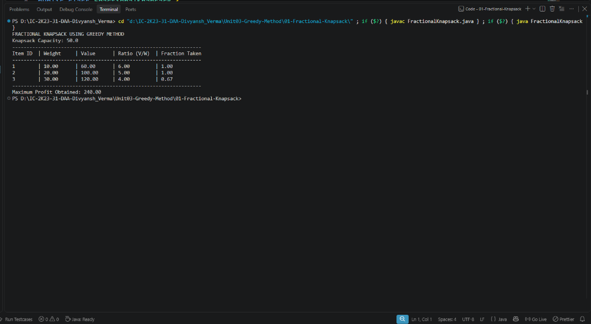

# Lab 01: Fractional Knapsack Problem

## 1. Problem Statement / Aim
To implement and analyze the Fractional Knapsack problem using the Greedy algorithmic strategy in Java, aiming to maximize the total profit earned without exceeding the given knapsack weight capacity.

---

## 2. Algorithm / Approach
The Fractional Knapsack problem exhibits the **greedy choice property** and **optimal substructure**. Unlike 0/1 knapsack, items can be broken down into fractional amounts.

1. **Calculate Profit-to-Weight Ratio:** For each item $i$, compute ratio $r_i = \frac{v_i}{w_i}$.
2. **Sort:** Sort all items in descending order of their profit-to-weight ratio $r_i$.
3. **Greedy Selection:**
   - Iterate through sorted items.
   - If the knapsack capacity accommodates the full item, take all of it ($fraction = 1.0$) and decrement capacity by $w_i$.
   - If remaining capacity is less than $w_i$, take a fraction $f = \frac{capacity_{remaining}}{w_i}$, add $f \times v_i$ to profit, and terminate since knapsack is full.

---

## 3. Pseudocode
```text
Algorithm FractionalKnapsack(weights, values, capacity, n):
    for i = 1 to n do:
        ratio[i] = values[i] / weights[i]
    sort items in descending order of ratio
    totalValue = 0.0
    currentCapacity = capacity

    for i = 1 to n do:
        if currentCapacity >= weights[i] then:
            currentCapacity = currentCapacity - weights[i]
            totalValue = totalValue + values[i]
        else if currentCapacity > 0 then:
            fraction = currentCapacity / weights[i]
            totalValue = totalValue + values[i] * fraction
            break
    return totalValue
```

---

## 4. Time & Space Complexity Analysis
- **Time Complexity:**
  - Ratio calculation: $\mathcal{O}(n)$
  - Sorting items by ratio: $\mathcal{O}(n \log n)$
  - Greedy item selection loop: $\mathcal{O}(n)$
  - **Overall Time Complexity:** $\mathcal{O}(n \log n)$
- **Space Complexity:**
  - Auxiliary space for storing sorted item wrappers: $\mathcal{O}(n)$
  - In-place sorting auxiliary space: $\mathcal{O}(1)$ to $\mathcal{O}(\log n)$

---

## 5. Sample Input
- Items:
  - Item 1: Weight = 10, Value = 60 (Ratio = 6.00)
  - Item 2: Weight = 20, Value = 100 (Ratio = 5.00)
  - Item 3: Weight = 30, Value = 120 (Ratio = 4.00)
- Knapsack Capacity: 50.0

---

## 6. Sample Output
```text
FRACTIONAL KNAPSACK USING GREEDY METHOD
Knapsack Capacity: 50.0
------------------------------------------------------------------
Item ID  | Weight     | Value      | Ratio (V/W)  | Fraction Taken
------------------------------------------------------------------
1        | 10.00      | 60.00      | 6.00         | 1.00          
2        | 20.00      | 100.00     | 5.00         | 1.00          
3        | 30.00      | 120.00     | 4.00         | 0.67          
------------------------------------------------------------------
Maximum Profit Obtained: 240.00
```

---

## 7. Output Screenshot
*(Screenshot will be uploaded upon test execution)*


---

## 8. Learning Outcomes
- Understood why the greedy choice property yields a globally optimal solution for fractional knapsack but fails for 0/1 knapsack.
- Learned how custom comparators in Java sort composite objects by computed metrics.
- Evaluated the computational trade-off between sorting overhead $\mathcal{O}(n \log n)$ and greedy selection $\mathcal{O}(n)$.
