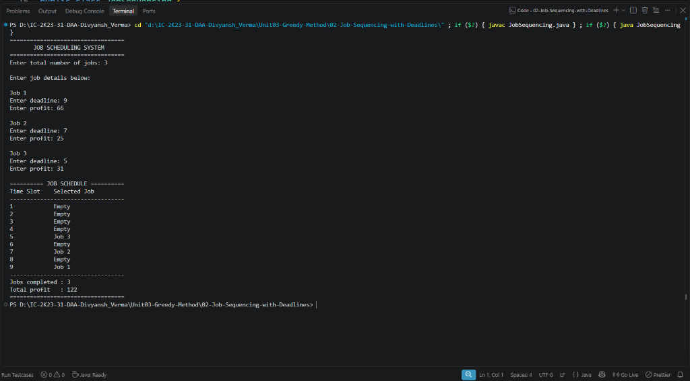

# Lab 02: Job Sequencing with Deadlines

## 1. Problem Statement / Aim
To implement and analyze the Job Sequencing with Deadlines problem using a greedy approach in Java, scheduling jobs within their respective deadlines to maximize total profit where each job takes 1 unit of time.

---

## 2. Algorithm / Approach
1. **Sort Jobs by Profit:** Sort all given jobs in strictly descending order of their profit values.
2. **Find Maximum Deadline:** Scan all jobs to find $d_{max}$ (the latest deadline among all jobs), defining the available discrete time slots $1, 2, \dots, d_{max}$.
3. **Greedy Slot Allocation:**
   - Iterate through each job in descending profit order.
   - For job $i$ with deadline $d_i$, search backwards from slot $\min(d_i, d_{max})$ down to slot 1 for the latest unoccupied slot.
   - If an empty slot is found, assign the job to that slot, mark the slot as filled, add the job's profit to total profit, and increment the scheduled job count.
   - If no slot is free before or at deadline $d_i$, discard the job.

---

## 3. Pseudocode
```text
Algorithm JobSequencing(Jobs, n):
    sort Jobs in descending order of profit
    d_max = max(Jobs[i].deadline for all i)
    slots = array of size (d_max + 1) initialized to null
    filled = boolean array of size (d_max + 1) initialized to false
    totalProfit = 0

    for i = 1 to n do:
        for j = min(Jobs[i].deadline, d_max) down to 1 do:
            if filled[j] is false then:
                filled[j] = true
                slots[j] = Jobs[i].id
                totalProfit = totalProfit + Jobs[i].profit
                break
    return slots, totalProfit
```

---

## 4. Time & Space Complexity Analysis
- **Time Complexity:**
  - Sorting jobs by profit: $\mathcal{O}(n \log n)$
  - Slot allocation: For each job, in the worst case scanning backwards through $d_{max}$ slots: $\mathcal{O}(n \times d_{max})$. (Can be optimized to $\mathcal{O}(n \alpha(d_{max}))$ using Disjoint Set Union).
  - **Overall Time Complexity:** $\mathcal{O}(n^2)$ (or $\mathcal{O}(n \times d_{max})$)
- **Space Complexity:**
  - Arrays `slots` and `filled` of size $d_{max} + 1$: $\mathcal{O}(d_{max})$
  - **Overall Space Complexity:** $\mathcal{O}(d_{max})$

---

## 5. Sample Input
| Job ID | Deadline | Profit |
| :--- | :--- | :--- |
| J1 | 2 | 100 |
| J2 | 1 | 19 |
| J3 | 2 | 27 |
| J4 | 1 | 25 |
| J5 | 3 | 15 |

---

## 6. Sample Output
```text
JOB SEQUENCING WITH DEADLINES (GREEDY METHOD)
--------------------------------------------
Job ID | Deadline   | Profit  
--------------------------------------------
J1     | 2          | 100     
J2     | 1          | 19      
J3     | 2          | 27      
J4     | 1          | 25      
J5     | 3          | 15      
--------------------------------------------
Scheduled Job Sequence:
Slot 1: J3
Slot 2: J1
Slot 3: J5

Total Jobs Scheduled: 3
Total Maximized Profit: 142
```

---

## 7. Output Screenshot


---

## 8. Learning Outcomes
- Understood why placing higher profit jobs as late as possible (at the boundary of their deadline) preserves earlier slots for jobs with tighter deadlines.
- Analyzed the performance difference between array-based slot search and disjoint-set-union (DSU) based slot allocation.
