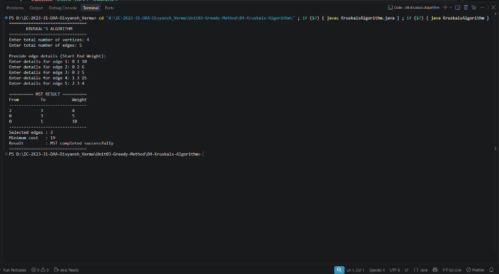

# Lab 04: Kruskal's Minimum Spanning Tree Algorithm

## 1. Problem Statement / Aim
To implement and analyze Kruskal's Algorithm in Java using a Disjoint Set Union (Union-Find) data structure to determine the Minimum Cost Spanning Tree (MST) of an edge-weighted connected undirected graph.

---

## 2. Algorithm / Approach
Kruskal's algorithm operates on edges globally rather than expanding from vertices:

1. **Sort Edges:** Sort all $E$ graph edges in ascending order of their weights.
2. **Disjoint Set Initialization:** Create a Disjoint Set Union (DSU) where each of the $V$ vertices initially resides in its own distinct subset ($parent[i] = i, rank[i] = 0$).
3. **Cycle-Free Greedy Selection:**
   - Iterate through sorted edges $(u, v, w)$.
   - Check if $u$ and $v$ belong to different connected components using `find()`.
   - If they are in different sets, adding edge $(u, v)$ does not create a cycle. Include $(u, v)$ in the MST and perform `union(u, v)`.
   - If they are in the same set, discard the edge to prevent cycle creation.
   - Terminate once exactly $V - 1$ edges have been successfully added.

---

## 3. Pseudocode
```text
Algorithm KruskalMST(edges, V):
    sort edges in non-decreasing order of weight
    ds = new DisjointSet(V)
    mst = empty list
    totalWeight = 0

    for each edge (u, v, weight) in edges do:
        if ds.union(u, v) is true then:
            mst.add((u, v, weight))
            totalWeight = totalWeight + weight
            if mst.size == V - 1 then:
                break

    return mst, totalWeight
```

---

## 4. Time & Space Complexity Analysis
- **Time Complexity:**
  - Sorting $E$ edges: $\mathcal{O}(E \log E)$ (since $E \le V^2$, $\log E = \mathcal{O}(\log V)$, so $\mathcal{O}(E \log V)$).
  - $V$ `makeset` operations and at most $2E$ `find` and $V-1$ `union` operations: $\mathcal{O}(E \alpha(V))$, where $\alpha$ is the nearly constant inverse Ackermann function.
  - **Overall Time Complexity:** $\mathcal{O}(E \log E)$ or $\mathcal{O}(E \log V)$.
- **Space Complexity:**
  - Disjoint Set arrays (`parent`, `rank`): $\mathcal{O}(V)$.
  - MST output edge array: $\mathcal{O}(V)$.
  - **Overall Space Complexity:** $\mathcal{O}(V + E)$.

---

## 5. Sample Input
- Vertices: 5
- Edges:
  - $(0, 1)$ wt 2, $(0, 3)$ wt 6, $(1, 2)$ wt 3, $(1, 3)$ wt 8, $(1, 4)$ wt 5, $(2, 4)$ wt 7, $(3, 4)$ wt 9

---

## 6. Sample Output
```text
KRUSKAL'S MINIMUM SPANNING TREE ALGORITHM
Number of Vertices: 5
Number of Edges:    7
-----------------------------------------
Edges in the Minimum Spanning Tree (MST):
Edge       | Weight  
---------------------
0 - 1       | 2       
1 - 2       | 3       
1 - 4       | 5       
0 - 3       | 6       
---------------------
Total Minimum Cost: 16
```

---

## 7. Output Screenshot


---

## 8. Learning Outcomes
- Mastered the union-find (DSU) data structure with path compression and union-by-rank.
- Understood why Kruskal's algorithm excels on sparse graphs ($E \ll V^2$) where sorting $E$ edges is fast.
