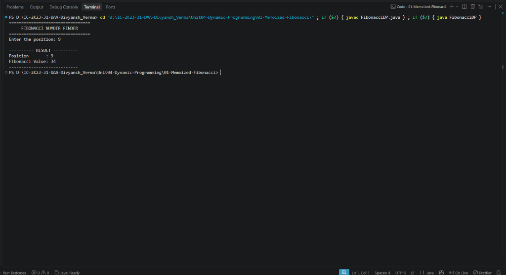

# Lab 01: Memoized Fibonacci Series

## 1. Problem Statement / Aim
To analyze the overlapping subproblems problem in recursive computation and implement the Fibonacci sequence using **Naive Recursion**, **Top-Down Dynamic Programming (Memoization)**, and **Bottom-Up Dynamic Programming (Tabulation)** in Java to compare their computational complexity and runtimes.

---

## 2. Algorithm / Approach
1. **Naive Recursion:** Direct evaluation of recurrence $F(n) = F(n-1) + F(n-2)$, which re-computes identical subproblems exponentially many times.
2. **Top-Down DP (Memoization):** Recursively solve subproblems, storing results in a lookup array `memo[]`. If a subproblem has been solved, return the stored value in $\mathcal{O}(1)$ time.
3. **Bottom-Up DP (Tabulation):** Iteratively compute subproblem values starting from base cases ($F[0]=0, F[1]=1$) up to $n$ in an array `table[]`.

---

## 3. Pseudocode
```text
Algorithm MemoizedFib(n, memo):
    if n <= 1 return n
    if memo[n] != 0 return memo[n]
    memo[n] = MemoizedFib(n - 1, memo) + MemoizedFib(n - 2, memo)
    return memo[n]

Algorithm TabulatedFib(n):
    if n <= 1 return n
    table[0] = 0, table[1] = 1
    for i = 2 to n do:
        table[i] = table[i - 1] + table[i - 2]
    return table[n]
```

---

## 4. Time & Space Complexity Analysis

| Paradigm | Time Complexity | Auxiliary Space Complexity |
| :--- | :--- | :--- |
| **Naive Recursion** | $\mathcal{O}(2^n)$ (Exponential) | $\mathcal{O}(n)$ (Call stack) |
| **Memoization (Top-Down)** | $\mathcal{O}(n)$ (Linear) | $\mathcal{O}(n)$ (Memo table + Call stack) |
| **Tabulation (Bottom-Up)** | $\mathcal{O}(n)$ (Linear) | $\mathcal{O}(n)$ (Table) or $\mathcal{O}(1)$ (Two variables) |

---

## 5. Sample Input
- Position: `6`

---

## 6. Sample Output
```text
=================================
     FIBONACCI NUMBER FINDER
=================================
Enter the position: 6

---------- RESULT ----------
Position       : 6
Fibonacci Value: 8
----------------------------
```

---

## 7. Output Screenshot


---

## 8. Learning Outcomes
- Demonstrated how memoization converts an exponential $\mathcal{O}(2^n)$ recurrence into a linear $\mathcal{O}(n)$ runtime.
- Identified the differences in overhead between top-down call stack recursion and bottom-up iterative table filling.
