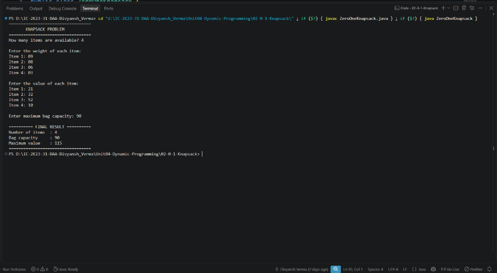

# Lab 02: 0/1 Knapsack Problem

## 1. Problem Statement / Aim
To implement and analyze the 0/1 Knapsack problem using Dynamic Programming in Java, determining the maximum achievable value from a set of discrete items without exceeding the total knapsack capacity, and reconstructing the selected items.

---

## 2. Algorithm / Approach
Unlike Fractional Knapsack, in 0/1 Knapsack items cannot be divided: an item must either be fully included ($1$) or excluded ($0$).

1. **DP Table Definition:** Define $dp[i][w]$ as the maximum value attainable using a subset of the first $i$ items with weight capacity $w$.
2. **Base Cases:** $dp[0][w] = 0$ for all $w$ (no items) and $dp[i][0] = 0$ for all $i$ (zero capacity).
3. **State Transition:**
   $$dp[i][w] = \begin{cases} \max(values[i-1] + dp[i-1][w - weights[i-1]], dp[i-1][w]) & \text{if } weights[i-1] \le w \\ dp[i-1][w] & \text{otherwise} \end{cases}$$
4. **Item Backtracking:** Backtrack from $dp[n][W]$ to identify which specific items contributed to the optimal value.

---

## 3. Pseudocode
```text
Algorithm ZeroOneKnapsack(values, weights, W, n):
    dp = 2D array of size (n + 1) x (W + 1) initialized to 0

    for i = 1 to n do:
        for w = 1 to W do:
            if weights[i - 1] <= w then:
                dp[i][w] = max(values[i - 1] + dp[i - 1][w - weights[i - 1]], dp[i - 1][w])
            else:
                dp[i][w] = dp[i - 1][w]

    return dp[n][W]
```

---

## 4. Time & Space Complexity Analysis
- **Time Complexity:**
  - Nested loops: $n$ items $\times (W + 1)$ capacities = $\mathcal{O}(n \times W)$ (Pseudo-polynomial time).
- **Space Complexity:**
  - DP table of size $(n+1) \times (W+1)$: $\mathcal{O}(n \times W)$.
  - Can be optimized to $\mathcal{O}(W)$ space using a single 1D array traversed backwards.

---

## 5. Sample Input
- Item Values: `[60, 100, 120]`
- Item Weights: `[10, 20, 30]`
- Capacity: `50`

---

## 6. Sample Output
```text
0/1 KNAPSACK OPTIMIZATION (DYNAMIC PROGRAMMING)
Knapsack Capacity: 50
----------------------------------------------
Maximum Profit: 220

Selected Items:
Item 3 -> Weight: 30, Value: 120
Item 2 -> Weight: 20, Value: 100
```

---

## 7. Output Screenshot


---

## 8. Learning Outcomes
- Understood why the greedy choice property fails for discrete 0/1 knapsack problems.
- Mastered bottom-up tabulation and backtracking through the DP state table to reconstruct the optimal solution set.
