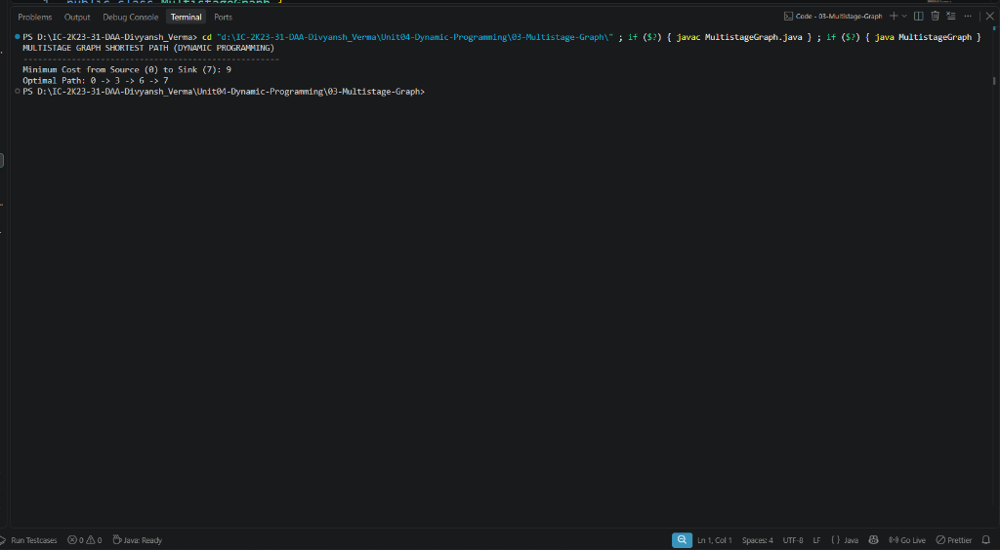

# Lab 03: Multistage Graph Shortest Path

## 1. Problem Statement / Aim
To formulate, implement, and analyze the backward Dynamic Programming approach in Java to determine the minimum cost path from source to sink in a directed, weighted multistage graph.

---

## 2. Algorithm / Approach
A multistage graph is a directed graph in which the vertices are partitioned into $k \ge 2$ disjoint sets (stages) $V_1, V_2, \dots, V_k$ such that if $(u, v)$ is an edge, then $u \in V_i$ and $v \in V_{i+1}$.

1. **Backward Approach:** Start from the destination (sink vertex $t \in V_k$) where $cost[t] = 0$.
2. **Recurrence Relation:** For every vertex $i$ from stage $k-1$ down to stage 1:
   $$cost[i] = \min_{j \in Adj(i)} \{ c(i, j) + cost[j] \}$$
3. **Record Decisions:** Maintain `nextVertex[i] = j` where $j$ minimizes the cost expression.
4. **Path Reconstruction:** Traverse forward from source $s = 0$ using `nextVertex` pointers until reaching sink $t$.

---

## 3. Pseudocode
```text
Algorithm MultistageGraph(graph, V):
    cost = array of size V filled with infinity
    nextVertex = array of size V
    cost[V - 1] = 0

    for i = V - 2 down to 0 do:
        for j = i + 1 to V - 1 do:
            if graph[i][j] != 0 then:
                if graph[i][j] + cost[j] < cost[i] then:
                    cost[i] = graph[i][j] + cost[j]
                    nextVertex[i] = j

    return cost[0], reconstructPath(nextVertex)
```

---

## 4. Time & Space Complexity Analysis
- **Time Complexity:**
  - In a graph with $V$ vertices and $E$ directed edges, each edge $(i, j)$ is examined exactly once: $\mathcal{O}(V + E)$ or $\mathcal{O}(V^2)$ with adjacency matrix.
- **Space Complexity:**
  - `cost[]` and `nextVertex[]` arrays of size $V$: $\mathcal{O}(V)$.

---

## 5. Sample Input
- 8-vertex, 4-stage graph representation:
  - Edges from stage 1 to stage 2: $(0,1)=1, (0,2)=2, (0,3)=5$
  - Edges from stage 2 to stage 3: $(1,4)=4, (1,5)=11, (2,4)=9, (2,5)=5, (2,6)=16, (3,6)=2$
  - Edges from stage 3 to stage 4: $(4,7)=18, (5,7)=13, (6,7)=2$

---

## 6. Sample Output
```text
MULTISTAGE GRAPH SHORTEST PATH (DYNAMIC PROGRAMMING)
-----------------------------------------------------
Minimum Cost from Source (0) to Sink (7): 9
Optimal Path: 0 -> 3 -> 6 -> 7
```

---

## 7. Output Screenshot


---

## 8. Learning Outcomes
- Understood how stage-based topological ordering enables efficient dynamic programming without cyclic dependencies.
- Learned the backward DP strategy for finding shortest paths in Directed Acyclic Graphs (DAGs).
