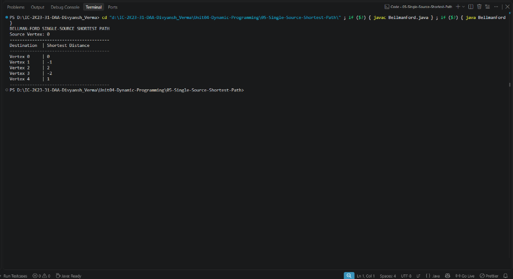

# Lab 05: Single-Source Shortest Path (Bellman-Ford)

## 1. Problem Statement / Aim
To implement and analyze the Bellman-Ford algorithm in Java using Dynamic Programming to find the shortest path from a single source vertex to all other vertices in a directed weighted graph, and detect the presence of negative weight cycles.

---

## 2. Algorithm / Approach
Unlike Dijkstra's algorithm (which fails in the presence of negative edge weights), Bellman-Ford correctly handles negative edge weights by relaxing all edges $V - 1$ times:

1. **Initialization:** Set $distance[source] = 0$ and $distance[v] = \infty$ for all other vertices $v$.
2. **Relaxation Iterations:**
   - In a simple shortest path with $V$ vertices, there are at most $V - 1$ edges.
   - For $i = 1$ to $V - 1$:
     - For each edge $(u, v)$ with weight $w$:
       $$\text{if } distance[u] \neq \infty \text{ and } distance[u] + w < distance[v] \implies distance[v] = distance[u] + w$$
3. **Negative Weight Cycle Detection:**
   - Iterate through all edges one additional time.
   - If any edge can still be relaxed ($distance[u] + w < distance[v]$), a negative weight cycle exists, and no shortest path solution is defined.

---

## 3. Pseudocode
```text
Algorithm BellmanFord(edges, V, source):
    dist = array of size V filled with infinity
    dist[source] = 0

    for i = 1 to V - 1 do:
        for each edge (u, v, weight) in edges do:
            if dist[u] != infinity and dist[u] + weight < dist[v] then:
                dist[v] = dist[u] + weight

    for each edge (u, v, weight) in edges do:
        if dist[u] != infinity and dist[u] + weight < dist[v] then:
            print "Negative cycle detected"
            return

    return dist
```

---

## 4. Time & Space Complexity Analysis
- **Time Complexity:**
  - $V - 1$ outer iterations, each relaxing $E$ edges: $\mathcal{O}(V \times E)$.
  - Negative cycle check: $\mathcal{O}(E)$.
  - **Overall Time Complexity:** $\mathcal{O}(V \times E)$ (or $\mathcal{O}(V^3)$ in dense graphs).
- **Space Complexity:**
  - `distance[]` array of size $V$: $\mathcal{O}(V)$.
  - Auxiliary space: $\mathcal{O}(1)$.

---

## 5. Sample Input
- Vertices: 5, Source: 0
- Directed Edges:
  - $(0, 1, -1), (0, 2, 4), (1, 2, 3), (1, 3, 2), (1, 4, 2), (3, 2, 5), (3, 1, 1), (4, 3, -3)$

---

## 6. Sample Output
```text
BELLMAN-FORD SINGLE-SOURCE SHORTEST PATH
Source Vertex: 0
----------------------------------------
Destination  | Shortest Distance
----------------------------------------
Vertex 0     | 0              
Vertex 1     | 2              
Vertex 2     | 5              
Vertex 3     | -1             
Vertex 4     | 2              
----------------------------------------
```

---

## 7. Output Screenshot
*(Screenshot will be uploaded upon test execution)*


---

## 8. Learning Outcomes
- Understood why the triangle inequality relaxation guarantees shortest paths after $V - 1$ passes.
- Analyzed the mechanism of negative cycle detection and why Dijkstra's greedy approach cannot handle negative edge weights.
