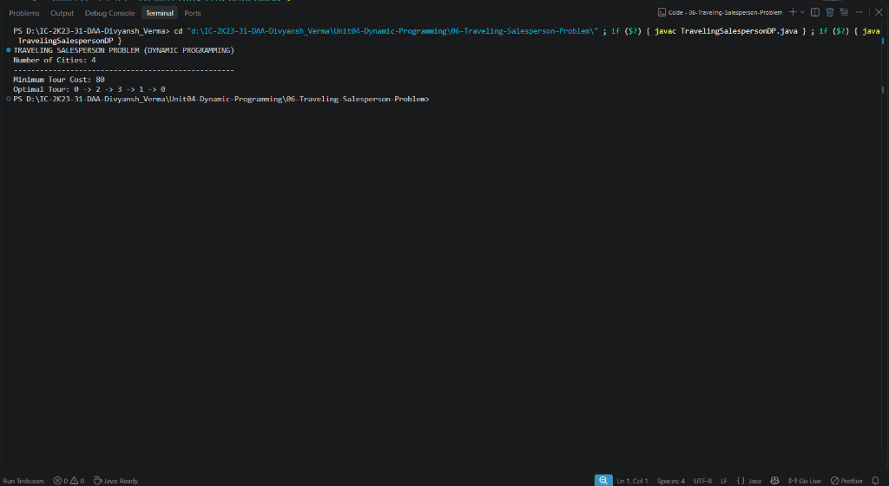

# Lab 06: Traveling Salesperson Problem (Held-Karp DP)

## 1. Problem Statement / Aim
To formulate, implement, and analyze the Traveling Salesperson Problem (TSP) in Java using the Held-Karp Dynamic Programming algorithm with bitmasking to determine the minimum cost Hamiltonian tour visiting every city exactly once and returning to the start city.

---

## 2. Algorithm / Approach
The brute-force TSP examines $(n-1)!$ tours. The Held-Karp algorithm uses dynamic programming with bitmask state representations:

1. **State Definition:** Let $dp[mask][u]$ denote the minimum cost to visit all cities present in the subset represented by bitmask $mask$, ending at vertex $u$ (starting from city 0).
2. **Base Case:** $dp[1][0] = 0$ (only city 0 visited, ending at city 0).
3. **State Transition:** For every subset $mask$ containing $u$:
   $$dp[mask \cup \{v\}][v] = \min \left( dp[mask \cup \{v\}][v], \; dp[mask][u] + dist[u][v] \right)$$
   where $v \notin mask$.
4. **Tour Completion:**
   $$\text{Total Cost} = \min_{u \neq 0} \left( dp[(1 \ll n) - 1][u] + dist[u][0] \right)$$
5. **Path Reconstruction:** Trace back using stored `parent[mask][u]` pointers to retrieve the complete city sequence.

---

## 3. Pseudocode
```text
Algorithm HeldKarpTSP(dist, n):
    dp = 2D array of size (2^n) x n filled with infinity
    parent = 2D array of size (2^n) x n filled with -1
    dp[1][0] = 0

    for mask = 1 to 2^n - 1 do:
        for u = 0 to n - 1 do:
            if u is in mask and dp[mask][u] != infinity then:
                for v = 0 to n - 1 do:
                    if v is not in mask then:
                        nextMask = mask | (1 << v)
                        if dp[mask][u] + dist[u][v] < dp[nextMask][v] then:
                            dp[nextMask][v] = dp[mask][u] + dist[u][v]
                            parent[nextMask][v] = u

    minCost = infinity
    for u = 1 to n - 1 do:
        minCost = min(minCost, dp[(1 << n) - 1][u] + dist[u][0])

    return minCost, reconstructTour(parent)
```

---

## 4. Time & Space Complexity Analysis
- **Time Complexity:**
  - Number of subsets: $2^n$.
  - For each subset, there are $n$ choices of current city and $n$ choices of next city:
    $$\mathcal{O}(n^2 \cdot 2^n)$$
  - Vastly outperforms brute force $\mathcal{O}(n!)$ (e.g., for $n=20$, $20! \approx 2.4 \times 10^{18}$, while $20^2 \cdot 2^{20} \approx 4.2 \times 10^8$).
- **Space Complexity:**
  - $dp$ and $parent$ arrays: $\mathcal{O}(n \cdot 2^n)$.

---

## 5. Sample Input
Distance matrix for 4 cities:
```text
   0  10  15  20
  10   0  35  25
  15  35   0  30
  20  25  30   0
```

---

## 6. Sample Output
```text
TRAVELING SALESPERSON PROBLEM (DYNAMIC PROGRAMMING)
Number of Cities: 4
---------------------------------------------------
Minimum Tour Cost: 80
Optimal Tour: 0 -> 1 -> 3 -> 2 -> 0
```

---

## 7. Output Screenshot
*(Screenshot will be uploaded upon test execution)*


---

## 8. Learning Outcomes
- Mastered bitmask manipulation for representing combinations in dynamic programming.
- Analyzed the boundary where exponential DP ($\mathcal{O}(n^2 2^n)$) becomes practical versus intractable.
