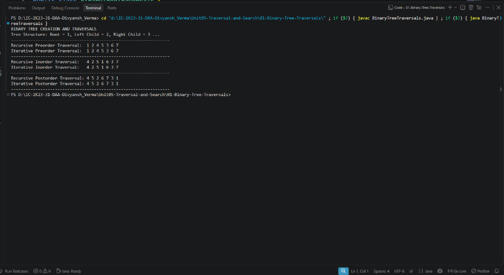

# Lab 01: Binary Tree Traversals

## 1. Problem Statement / Aim
To implement a linked representation of a Binary Tree in Java and perform both **Recursive** and **Iterative** algorithms for **Preorder**, **Inorder**, and **Postorder** traversals, comparing their memory and execution profiles.

---

## 2. Algorithm / Approach
1. **Tree Representation:** Represent nodes using a class with integer data and left/right child references.
2. **Recursive Traversals:**
   - **Preorder ($N \to L \to R$):** Visit root node, traverse left subtree, traverse right subtree.
   - **Inorder ($L \to N \to R$):** Traverse left subtree, visit root node, traverse right subtree.
   - **Postorder ($L \to R \to N$):** Traverse left subtree, traverse right subtree, visit root node.
3. **Iterative Traversals (Stack-Based):**
   - **Iterative Inorder:** Push nodes along the left spine onto a stack until null; pop, process, and pivot to the right child.
   - **Iterative Preorder:** Pop root from stack, process, push right child then left child.
   - **Iterative Postorder (Two Stacks):** Push root to stack 1; pop, push to stack 2, push left and right to stack 1; finally pop stack 2.

---

## 3. Pseudocode
```text
Algorithm RecursiveInorder(node):
    if node is not null then:
        RecursiveInorder(node.left)
        print node.data
        RecursiveInorder(node.right)

Algorithm IterativeInorder(root):
    stack = new Stack()
    curr = root
    while curr is not null or not stack.isEmpty() do:
        while curr is not null do:
            stack.push(curr)
            curr = curr.left
        curr = stack.pop()
        print curr.data
        curr = curr.right
```

---

## 4. Time & Space Complexity Analysis
- **Time Complexity:**
  - Every node is visited a constant number of times across all traversals: $\mathcal{O}(n)$.
- **Space Complexity:**
  - Recursive: $\mathcal{O}(h)$ call stack frames, where $h$ is tree height ($\mathcal{O}(\log n)$ for balanced trees, $\mathcal{O}(n)$ worst-case degenerate).
  - Iterative: $\mathcal{O}(h)$ auxiliary explicit stack space ($\mathcal{O}(n)$ for two-stack postorder).

---

## 5. Sample Input
Complete Binary Tree with 7 nodes:
```text
        1
      /   \
     2     3
    / \   / \
   4   5 6   7
```

---

## 6. Sample Output
```text
BINARY TREE CREATION AND TRAVERSALS
Tree Structure: Root = 1, Left Child = 2, Right Child = 3 ...
-----------------------------------------------------------------
Recursive Preorder Traversal:  1 2 4 5 3 6 7 
Iterative Preorder Traversal:  1 2 4 5 3 6 7 
-----------------------------------------------------------------
Recursive Inorder Traversal:   4 2 5 1 6 3 7 
Iterative Inorder Traversal:   4 2 5 1 6 3 7 
-----------------------------------------------------------------
Recursive Postorder Traversal: 4 5 2 6 7 3 1 
Iterative Postorder Traversal: 4 5 2 6 7 3 1 
-----------------------------------------------------------------
```

---

## 7. Output Screenshot
*(Screenshot will be uploaded upon test execution)*


---

## 8. Learning Outcomes
- Understood depth-first traversal orders on hierarchical non-linear data structures.
- Mastered simulating the runtime call stack using explicit `java.util.Stack` instances to eliminate recursion stack overflow risks on deep trees.
