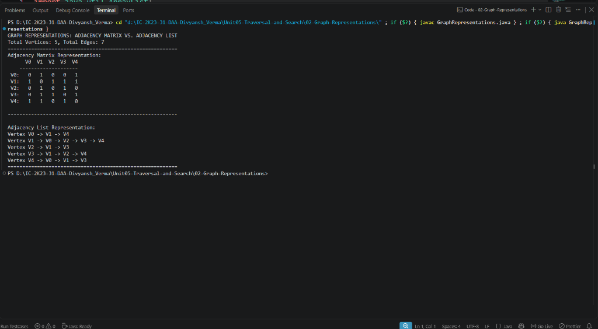

# Lab 02: Graph Representations (Adjacency Matrix & Adjacency List)

## 1. Problem Statement / Aim
To implement and analyze the two primary graph representation paradigms in Java—**Adjacency Matrix** and **Adjacency List**—for an undirected graph, evaluating their trade-offs in storage efficiency and edge query time.

---

## 2. Algorithm / Approach
1. **Adjacency Matrix:**
   - A $2\text{D}$ integer array of size $V \times V$.
   - If an edge exists between vertex $u$ and vertex $v$, $matrix[u][v] = 1$ and $matrix[v][u] = 1$; otherwise $0$.
   - Best for dense graphs ($E \approx V^2$) and instantaneous edge lookup $\mathcal{O}(1)$.
2. **Adjacency List:**
   - An array or dynamic list of lists, where list $u$ contains all vertices directly adjacent to $u$.
   - Best for sparse graphs ($E \ll V^2$) minimizing unused memory allocations.

---

## 3. Comparison Matrix

| Operation | Adjacency Matrix | Adjacency List |
| :--- | :--- | :--- |
| **Storage Space** | $\mathcal{O}(V^2)$ | $\mathcal{O}(V + E)$ |
| **Add Edge** | $\mathcal{O}(1)$ | $\mathcal{O}(1)$ |
| **Check if $(u, v)$ is Edge** | $\mathcal{O}(1)$ | $\mathcal{O}(\text{degree}(u))$ |
| **Iterate over Neighbors of $u$** | $\mathcal{O}(V)$ | $\mathcal{O}(\text{degree}(u))$ |

---

## 4. Pseudocode
```text
Class AdjacencyMatrix(V):
    matrix = 2D array of size V x V initialized to 0
    function addEdge(u, v):
        matrix[u][v] = 1
        matrix[v][u] = 1

Class AdjacencyList(V):
    list = array of V dynamic lists
    function addEdge(u, v):
        list[u].add(v)
        list[v].add(u)
```

---

## 5. Sample Input
- 5 vertices ($V0$ to $V4$), 7 undirected edges:
  - $(0, 1), (0, 4), (1, 2), (1, 3), (1, 4), (2, 3), (3, 4)$

---

## 6. Sample Output
```text
GRAPH REPRESENTATIONS: ADJACENCY MATRIX VS. ADJACENCY LIST
Total Vertices: 5, Total Edges: 7
==========================================================
Adjacency Matrix Representation:
      V0  V1  V2  V3  V4
    --------------------
 V0:   0   1   0   0   1
 V1:   1   0   1   1   1
 V2:   0   1   0   1   0
 V3:   0   1   1   0   1
 V4:   1   1   0   1   0

----------------------------------------------------------

Adjacency List Representation:
Vertex V0 -> V1 -> V4
Vertex V1 -> V0 -> V2 -> V3 -> V4
Vertex V2 -> V1 -> V3
Vertex V3 -> V1 -> V2 -> V4
Vertex V4 -> V0 -> V1 -> V3
==========================================================
```

---

## 7. Output Screenshot
*(Screenshot will be uploaded upon test execution)*


---

## 8. Learning Outcomes
- Contrasted space-bound memory footprints between quadratic $\mathcal{O}(V^2)$ matrix storage and linear $\mathcal{O}(V + E)$ list storage.
- Identified the impact of representation choice on subsequent graph search algorithms like BFS and DFS.
