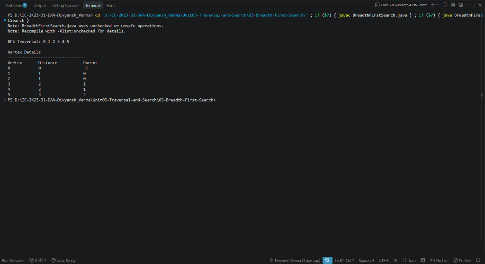

# Lab 03: Breadth First Search (BFS) Traversal

## 1. Problem Statement / Aim
To implement and analyze the Breadth First Search (BFS) algorithm in Java using a Queue data structure to traverse all vertices of a graph in level-by-level order and compute unweighted shortest paths.

---

## 2. Algorithm / Approach
Breadth First Search explores all neighbor vertices at the current depth prior to moving on to vertices at the next depth level:

1. **Queue-Based Exploration:** Maintain a FIFO `Queue` initialized with the source vertex $s$.
2. **State Tracking:**
   - `visited[]`: Boolean array preventing redundant vertex reprocessing and infinite loops in cyclic graphs.
   - `distance[]`: Integer array recording the shortest unweighted hop distance from the source.
   - `parent[]`: Integer array recording the predecessor vertex in the BFS exploration tree.
3. **Traversal Loop:**
   - Dequeue vertex $u$.
   - For each adjacent vertex $v$ of $u$:
     - If $v$ is unvisited: mark $v$ as visited, set $distance[v] = distance[u] + 1$, set $parent[v] = u$, and enqueue $v$.
   - Repeat until the queue is exhausted.

---

## 3. Pseudocode
```text
Algorithm BFS(graph, source, V):
    visited = boolean array of size V filled with false
    distance = array of size V filled with -1
    parent = array of size V filled with -1
    queue = new Queue()

    visited[source] = true
    distance[source] = 0
    queue.enqueue(source)

    while not queue.isEmpty() do:
        u = queue.dequeue()
        process(u)
        for each neighbor v of u do:
            if not visited[v] then:
                visited[v] = true
                distance[v] = distance[u] + 1
                parent[v] = u
                queue.enqueue(v)
```

---

## 4. Time & Space Complexity Analysis
- **Time Complexity:**
  - With Adjacency List: Every vertex is enqueued/dequeued once ($\mathcal{O}(V)$), and every edge is scanned twice ($\mathcal{O}(E)$):
    $$\mathcal{O}(V + E)$$
  - With Adjacency Matrix: $\mathcal{O}(V^2)$.
- **Space Complexity:**
  - `Queue`, `visited`, `distance`, `parent` arrays: $\mathcal{O}(V)$.

---

## 5. Sample Input
Graph with $V = 6$ vertices and edges:
- $(0, 1), (0, 2), (1, 3), (1, 4), (2, 4), (3, 5), (4, 5)$
- Starting vertex: $V0$

---

## 6. Sample Output
```text
BREADTH FIRST SEARCH (BFS) TRAVERSAL
Starting Vertex: V0
--------------------------------------------------
BFS Traversal Order: V0 V1 V2 V3 V4 V5 
--------------------------------------------------
Vertex     | Shortest Level   | Parent    
--------------------------------------------------
V0         | 0                | None (Root)
V1         | 1                | V0        
V2         | 1                | V0        
V3         | 2                | V1        
V4         | 2                | V1        
V5         | 3                | V3        
--------------------------------------------------
```

---

## 7. Output Screenshot


---

## 8. Learning Outcomes
- Understood why FIFO queuing naturally computes minimum edge hop counts in unweighted graphs.
- Learned to construct BFS spanning trees using parent pointers.
