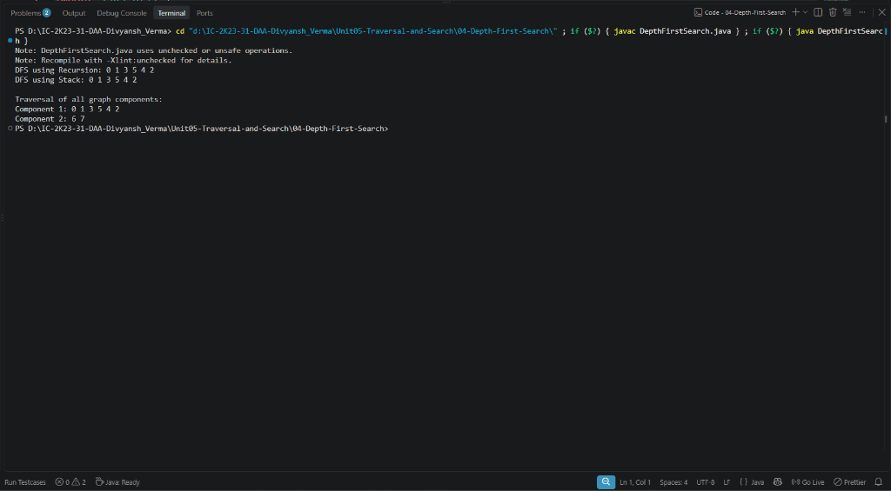

# Lab 04: Depth First Search (DFS) Traversal

## 1. Problem Statement / Aim
To implement and analyze the Depth First Search (DFS) algorithm in Java using both **Recursive** (system stack) and **Iterative** (explicit stack) approaches to traverse all reachable vertices of a graph.

---

## 2. Algorithm / Approach
Depth First Search explores as deeply as possible along each branch before backtracking:

1. **Recursive DFS:**
   - Mark current vertex $u$ as visited.
   - For each unvisited neighbor $v \in Adj(u)$, recursively invoke DFS on $v$.
   - Naturally utilizes the runtime call stack for backtracking.
2. **Iterative DFS:**
   - Push start vertex onto an explicit `Stack`.
   - While stack is not empty, pop vertex $u$.
   - If not visited: mark visited, and push unvisited neighbors onto the stack (pushed in reverse order to match recursive exploration order).

---

## 3. Pseudocode
```text
Algorithm RecursiveDFS(u, visited, adj):
    visited[u] = true
    process(u)
    for each v in adj[u] do:
        if not visited[v] then:
            RecursiveDFS(v, visited, adj)

Algorithm IterativeDFS(source, adj, V):
    visited = boolean array of size V filled with false
    stack = new Stack()
    stack.push(source)

    while not stack.isEmpty() do:
        u = stack.pop()
        if not visited[u] then:
            visited[u] = true
            process(u)
            for each neighbor v of u (in reverse) do:
                if not visited[v] then:
                    stack.push(v)
```

---

## 4. Time & Space Complexity Analysis
- **Time Complexity:**
  - With Adjacency List: $\mathcal{O}(V + E)$
  - With Adjacency Matrix: $\mathcal{O}(V^2)$
- **Space Complexity:**
  - Recursion call stack depth / explicit stack: $\mathcal{O}(V)$
  - `visited[]` array: $\mathcal{O}(V)$
  - Total auxiliary space: $\mathcal{O}(V)$.

---

## 5. Sample Input
Graph with 6 vertices and edges:
- $(0, 1), (0, 2), (1, 3), (1, 4), (2, 4), (3, 5), (4, 5)$
- Starting vertex: $V0$

---

## 6. Sample Output
```text
DEPTH FIRST SEARCH (DFS) TRAVERSAL
Starting Vertex: V0
--------------------------------------------------
Recursive DFS Traversal: V0 V1 V3 V5 V4 V2 
Iterative DFS Traversal: V0 V1 V3 V5 V4 V2 
--------------------------------------------------
```

---

## 7. Output Screenshot


---

## 8. Learning Outcomes
- Understood recursive state exploration and how explicit stack iteration mimics call-stack recursion.
- Recognized core applications of DFS: topological sorting, cycle detection, and strongly connected components (Tarjan/Kosaraju).
