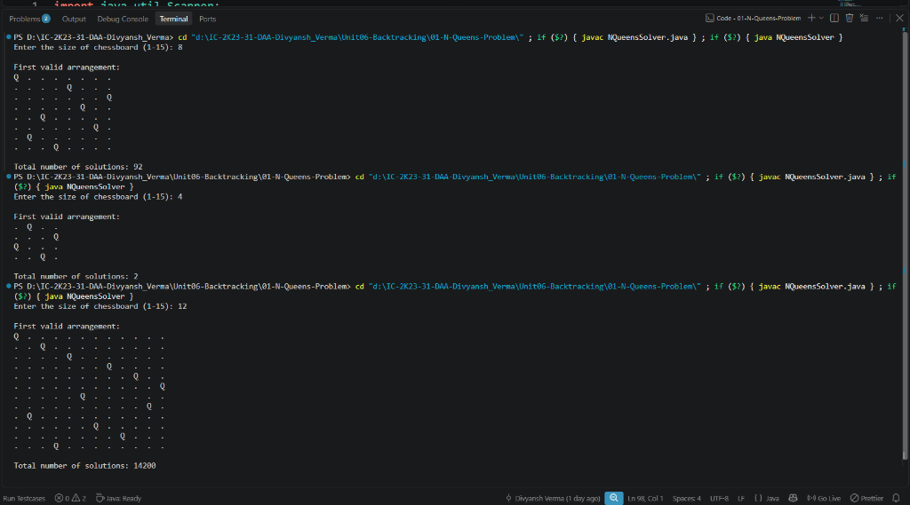

# Lab 01: N-Queens Problem using Backtracking

## 1. Problem Statement / Aim
To formulate, implement, and analyze the general Backtracking technique in Java for placing $N$ non-attacking queens on an $N \times N$ chessboard such that no two queens share the same row, column, or diagonal, and evaluate total distinct solutions for 4-Queens and 8-Queens.

---

## 2. Algorithm / Approach
The search space for placing $N$ queens on an $N \times N$ board has $N^N$ configurations (or $\binom{N^2}{N}$ exhaustively). Backtracking prunes non-promising subtrees early:

1. **Board Representation:** A 1D integer array `board[N]` where `board[i] = c` means a queen is placed at row $i$ and column $c$, automatically satisfying the constraint of one queen per row.
2. **Safety Check (`isSafe`):**
   - For a candidate position $(row, col)$, verify that no queen already placed at row $i < row$:
     - Shares the same column ($board[i] == col$).
     - Shares a diagonal ($|board[i] - col| == |i - row|$).
3. **Recursive Backtracking:**
   - Attempt placing a queen in columns $0 \dots N-1$ for the current row.
   - If safe, record choice and recursively proceed to row $+ 1$.
   - If a dead end is reached (no valid column in subsequent rows), backtrack by unwinding the choice.
   - When row reaches $N$, a valid full solution has been identified.

---

## 3. Pseudocode
```text
Algorithm PlaceQueens(row, n, board):
    if row == n then:
        recordSolution(board)
        return

    for col = 0 to n - 1 do:
        if isSafe(board, row, col) then:
            board[row] = col
            PlaceQueens(row + 1, n, board)
```

---

## 4. Time & Space Complexity Analysis
- **Time Complexity:**
  - In the worst case, the state-space tree explores $\mathcal{O}(N!)$ nodes.
  - For $N=8$, only $2,057$ state tree nodes are tested out of $8^8 \approx 16.7 \times 10^6$ combinations, finding all $92$ solutions rapidly.
- **Space Complexity:**
  - Board representation: $\mathcal{O}(N)$.
  - Recursion stack: $\mathcal{O}(N)$.
  - Total auxiliary space: $\mathcal{O}(N)$.

---

## 5. Sample Output
```text
N-QUEENS PROBLEM USING BACKTRACKING
==================================================
Solving 4-Queens Problem:
Board Configuration (First Valid Placement):
  Row 0: [.] [Q] [.] [.] 
  Row 1: [.] [.] [.] [Q] 
  Row 2: [Q] [.] [.] [.] 
  Row 3: [.] [.] [Q] [.] 
Total Distinct Solutions for 4-Queens: 2

--------------------------------------------------

Solving 8-Queens Problem:
Board Configuration (First Valid Placement):
  Row 0: [Q] [.] [.] [.] [.] [.] [.] [.] 
  Row 1: [.] [.] [.] [.] [Q] [.] [.] [.] 
  Row 2: [.] [.] [.] [.] [.] [.] [.] [Q] 
  Row 3: [.] [.] [.] [.] [.] [Q] [.] [.] 
  Row 4: [.] [.] [Q] [.] [.] [.] [.] [.] 
  Row 5: [.] [.] [.] [.] [.] [.] [Q] [.] 
  Row 6: [.] [Q] [.] [.] [.] [.] [.] [.] 
  Row 7: [.] [.] [.] [Q] [.] [.] [.] [.] 
Total Distinct Solutions for 8-Queens: 92
==================================================
```

---

## 6. Output Screenshot
*(Screenshot will be uploaded upon test execution)*


---

## 7. Learning Outcomes
- Understood state-space tree traversal and systematic bounding/pruning.
- Observed exponential search-space reduction via constraint checking.
