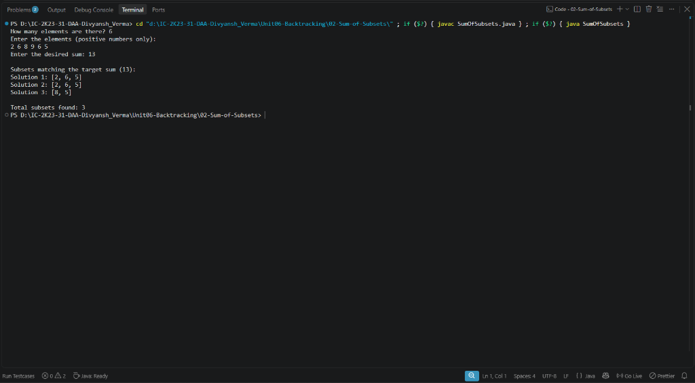

# Lab 02: Sum of Subsets Problem using Backtracking

## 1. Problem Statement / Aim
To implement and analyze the Sum of Subsets problem in Java using Backtracking with bounding functions to determine all distinct subsets of a given set of positive integers whose sum equals a target value $M$.

---

## 2. Algorithm / Approach
The state space of all possible subsets forms a binary tree of size $2^n$. Bounding functions prune unfeasible branches:

1. **Sort Array:** Sort input numbers in ascending order to enable early termination.
2. **Bounding Conditions:**
   - **Over-Sum Pruning:** If $currentSum + numbers[i] > targetSum$, prune this and all subsequent sibling branches since the array is sorted.
   - **Under-Sum Pruning:** If $currentSum + remainingSum < targetSum$, even including all remaining elements cannot reach the target; prune the current subtree.
3. **Backtracking Loop:**
   - Include element $numbers[i]$ in current subset.
   - Recurse on remaining elements with updated running sum and remaining sum.
   - Backtrack by removing $numbers[i]$.

---

## 3. Pseudocode
```text
Algorithm SumOfSubsets(numbers, index, currentSum, remainingSum, targetSum, subset):
    if currentSum == targetSum then:
        recordSolution(subset)
        return

    for i = index to n - 1 do:
        if currentSum + numbers[i] > targetSum then break
        if currentSum + remainingSum < targetSum then return

        subset.add(numbers[i])
        SumOfSubsets(numbers, i + 1, currentSum + numbers[i], remainingSum - numbers[i], targetSum, subset)
        subset.removeLast()
```

---

## 4. Time & Space Complexity Analysis
- **Time Complexity:**
  - Worst case: $\mathcal{O}(2^n)$ when all combinations must be checked.
  - Average case with pruning: drastically faster than $2^n$ because of dual bounding checks.
- **Space Complexity:**
  - Recursion call stack: $\mathcal{O}(n)$.
  - Stored subset: $\mathcal{O}(n)$.
  - Total auxiliary space: $\mathcal{O}(n)$.

---

## 5. Sample Input
- Positive integer set: `[10, 7, 5, 18, 12, 20, 15]`
- Target Sum: `35`

---

## 6. Sample Output
```text
SUM OF SUBSETS PROBLEM USING BACKTRACKING
Given Set: [5, 7, 10, 12, 15, 18, 20]
Target Sum: 35
-----------------------------------------
Solution 1: [5, 10, 20]
Solution 2: [5, 12, 18]
Solution 3: [7, 10, 18]
Solution 4: [15, 20]
-----------------------------------------
Total Valid Subsets Found: 4
```

---

## 7. Output Screenshot
*(Screenshot will be uploaded upon test execution)*


---

## 8. Learning Outcomes
- Understood state-space tree generation using the subset-sum paradigm.
- Mastered two-sided bounding functions ($>\text{target}$ and $<\text{target}-\text{remaining}$) for optimal subtree pruning.
