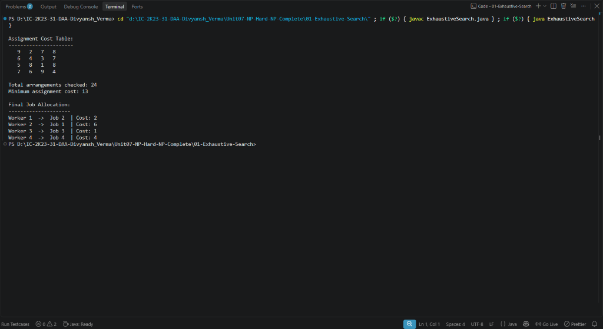

# Lab 01: Exhaustive (Brute-Force) Search Demonstration

## 1. Problem Statement / Aim
To formulate and implement an Exhaustive (Brute-Force) Search algorithm in Java for a combinatorial optimization problem (Job Assignment Problem) that systematically evaluates all $n!$ candidate worker-to-job permutations, finding the optimal assignment that minimizes total cost.

---

## 2. Algorithm / Approach
Exhaustive search systematically generates and evaluates all permutations of job allocations:

1. **State Space Enumeration:** For an assignment problem with $n$ workers and $n$ jobs, there are $n!$ possible permutations of assignments.
2. **Lexicographical Permutation Generation:** Start with initial permutation `[0, 1, ..., n-1]` and generate the next lexicographical permutation using element swapping and suffix reversal.
3. **Evaluation:** For each candidate arrangement, sum the individual assignment expenses: $\sum_{i=0}^{n-1} expenses[i][arrangement[i]]$.
4. **Optimal Tracking:** Update the minimum cost and store the optimal assignment arrangement whenever a lower total cost is discovered.

---

## 3. Sample Input & Output
```text
Assignment Cost Table:
----------------------
   9   2   7   8
   6   4   3   7
   5   8   1   8
   7   6   9   4

Total arrangements checked: 24
Minimum assignment cost: 13

Final Job Allocation:
---------------------
Worker 1  ->  Job 2  | Cost: 2
Worker 2  ->  Job 1  | Cost: 6
Worker 3  ->  Job 3  | Cost: 1
Worker 4  ->  Job 4  | Cost: 4
```

---

## 4. Complexity Analysis
- **Time Complexity:** $\mathcal{O}(n \cdot n!)$ — generates all $n!$ permutations, spending $\mathcal{O}(n)$ to evaluate each configuration.
- **Space Complexity:** $\mathcal{O}(n)$ auxiliary space to store current and best assignment permutations.

---

## 5. Output Screenshot


---

## 6. Learning Outcomes
- Understood the mechanics of complete permutation generation for combinatorial optimization.
- Observed the factorial growth $\mathcal{O}(n!)$ of unpruned state spaces in NP-hard assignment problems.
