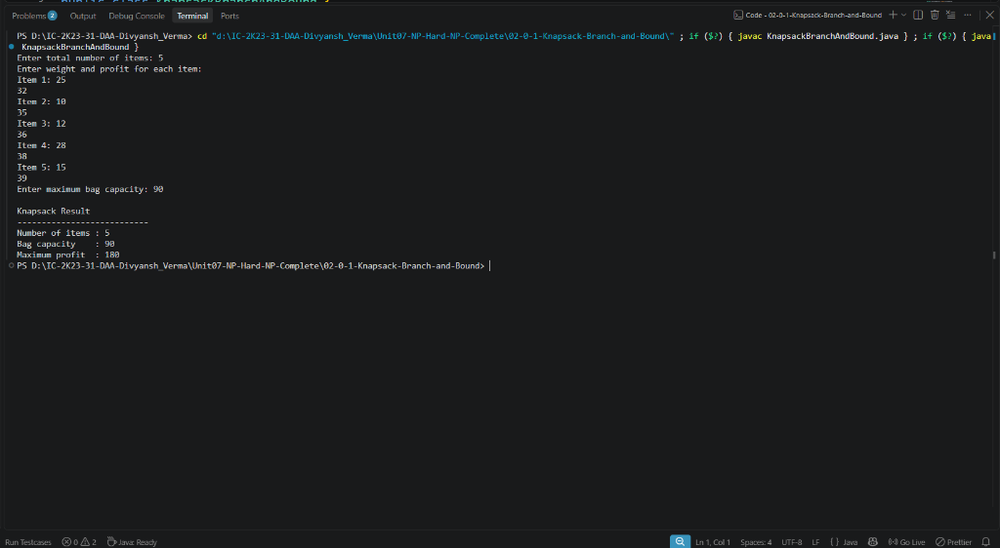

# Lab 02: 0/1 Knapsack using Branch and Bound

## 1. Problem Statement / Aim
To design, implement, and analyze the 0/1 Knapsack optimization problem in Java using the Least-Cost Branch and Bound (LCBB) paradigm with fractional knapsack bounding functions to prune sub-optimal subtrees.

---

## 2. Algorithm / Approach
Unlike Backtracking (DFS state exploration) or DP (tabulation across discrete weights), Branch and Bound uses a best-first state exploration strategy:

1. **Sorting by Efficiency:** Sort items in descending order of value-to-weight ratio $v_i / w_i$.
2. **Bounding Function:** At any state node $u$ with current profit and weight, compute an **upper bound** by greedily filling remaining capacity with remaining items (allowing fractional splitting of the first non-fitting item).
3. **Least-Cost (Best-First) Search:**
   - Store active live nodes in a Max-Heap Priority Queue ordered by upper bound.
   - At each step, dequeue the live node with the highest upper bound.
   - Generate two child nodes:
     - Left child: Include item at `level + 1`.
     - Right child: Exclude item at `level + 1`.
   - Pruning Condition: If child node's upper bound $\le currentMaxProfit$, prune the node and do not insert into the priority queue.

---

## 3. Pseudocode
```text
Algorithm KnapsackLCBB(items, W, n):
    sort items by ratio descending
    pq = new MaxPriorityQueue(ordered by bound)
    root = new Node(level = -1, profit = 0, weight = 0)
    root.bound = computeBound(root, W, items)
    pq.insert(root)
    maxProfit = 0

    while not pq.isEmpty() do:
        curr = pq.extractMax()
        if curr.bound > maxProfit then:
            leftChild = includeItem(curr)
            if leftChild.weight <= W and leftChild.profit > maxProfit then:
                maxProfit = leftChild.profit
            if leftChild.bound > maxProfit then:
                pq.insert(leftChild)

            rightChild = excludeItem(curr)
            if rightChild.bound > maxProfit then:
                pq.insert(rightChild)

    return maxProfit
```

---

## 4. Time & Space Complexity Analysis
- **Time Complexity:**
  - Worst Case: $\mathcal{O}(2^n)$ when bounding function cannot prune branches.
  - Average Case: Dramatically faster than $2^n$ and independent of numerical magnitude of $W$ (unlike DP pseudo-polynomial $\mathcal{O}(nW)$).
- **Space Complexity:**
  - Priority Queue storing live active nodes: $\mathcal{O}(2^n)$ worst case, typically $\mathcal{O}(n)$ to $\mathcal{O}(2^{n/2})$.

---

## 5. Sample Input & Output
```text
0/1 KNAPSACK PROBLEM (BRANCH AND BOUND - LC SEARCH)
Total Items: 5, Knapsack Capacity: 10
---------------------------------------------------
Maximum Profit Achieved: 245
Total State-Space Nodes Explored: 9
---------------------------------------------------
```

---

## 6. Output Screenshot
*(Screenshot will be uploaded upon test execution)*


---

## 7. Learning Outcomes
- Mastered Best-First Search guided by continuous mathematical relaxations.
- Contrasted Branch and Bound with Dynamic Programming: B&B handles fractional/large non-integer capacities $W$ where DP matrix allocation becomes infeasible.
