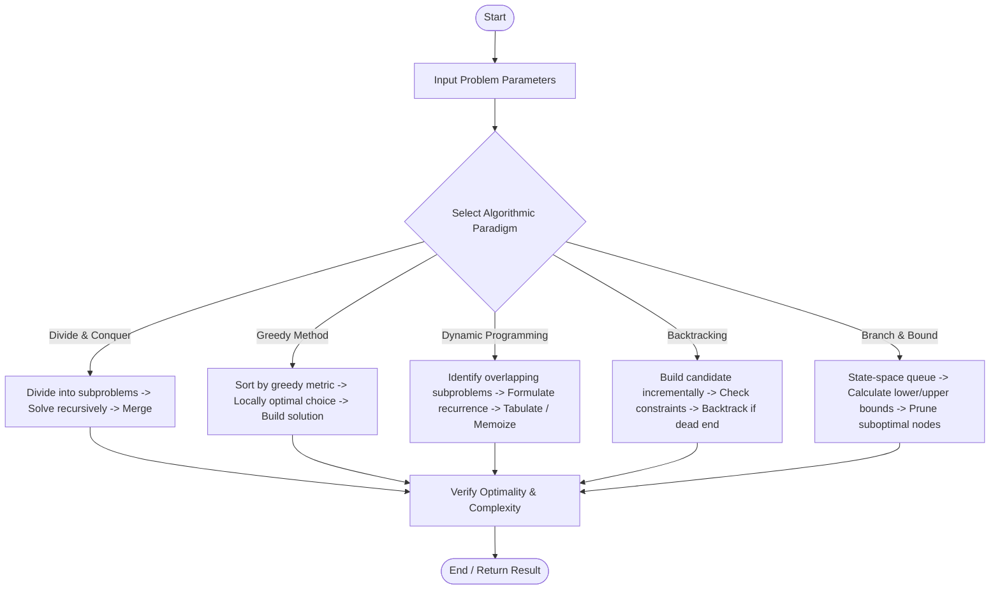

# Algorithm Flowcharts

This directory contains algorithmic flowcharts and logic flow diagrams for core algorithms across all units of Design and Analysis of Algorithms (IC-709 B).

## Flowchart Index
1. **Divide and Conquer:** Merge Sort, Quick Sort, Binary Search
2. **Greedy Method:** Fractional Knapsack, Prim's & Kruskal's MST
3. **Dynamic Programming:** 0/1 Knapsack, Floyd-Warshall, TSP
4. **Backtracking:** N-Queens, Sum of Subsets
5. **Branch and Bound:** 0/1 Knapsack LCBB, TSP Reduced Cost Matrix
