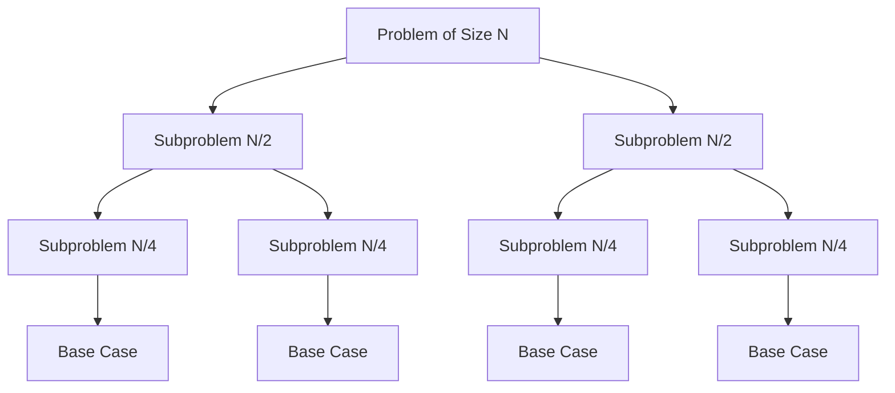
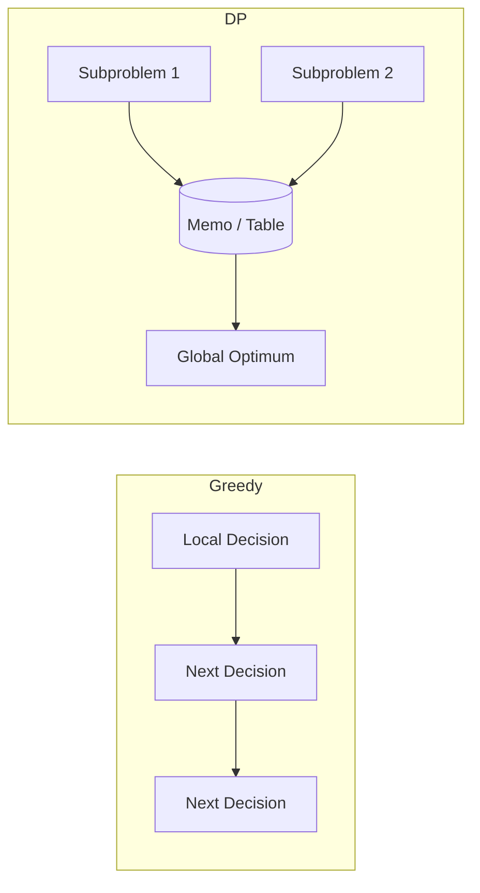
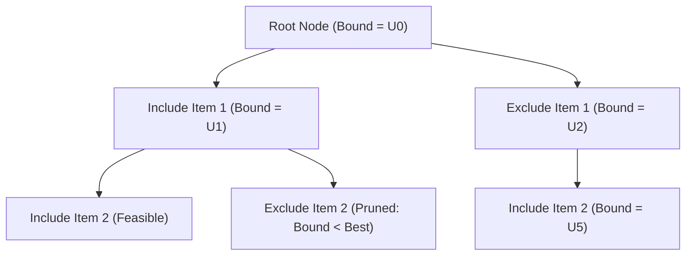

# Algorithmic Architecture Diagrams

Visual representation of data structures, state space trees, and memory models.

## 1. Divide and Conquer Tree

## 2. Dynamic Programming vs. Greedy Choice

## 3. Branch and Bound State Space Tree

